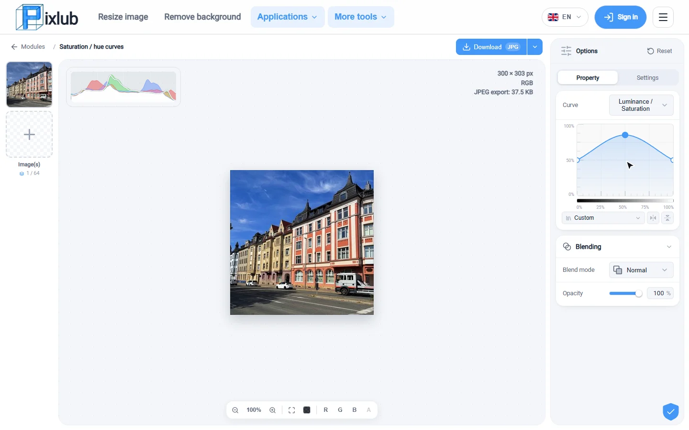

# Curvas de saturación / tono

Ajustar la saturación o el tono de cada color según su luminancia, su saturación o su tono.

**Categoría** : Ajuste · **Identificador** : `hueSatCurves` · [Referencia de la API](./api.md)

## Dónde usarlo

- **[Página del módulo](https://pixlub.com/es/module/hueSatCurves)** : Suelte sus archivos, ajuste y descargue: el módulo por sí solo, sin nada más.
- **[Grafo de imagen](https://pixlub.com/es/image/graph)** : Conéctelo a otros módulos para componer un efecto más complejo.

## Entradas

Los archivos que acepta la página del módulo: suéltelos en la zona de importación o haga clic en ella para buscarlos. Un archivo de otro formato se descarta, con un mensaje que recuerda los formatos permitidos.

| Entrada | Formatos aceptados | Archivos |
| --- | --- | --- |
| **Imagen(es)** (obligatoria) Imagen cuyo tono o saturación se ajusta con las curvas. | `PNG`, `JPEG`, `WebP`, `GIF`, `AVIF`, `BMP` | Uno o varios: cada imagen se procesa por separado, con los mismos ajustes |

El número de imágenes que se procesan a la vez depende de su plan.

Mediante la API, los archivos y sus formatos se detallan en la [vista API](./api.md).

## Presentación en video

▶ [Ver el video](../../../../assets/modules/hueSatCurves/demo.en.mp4) : Saturación según la luminancia y luego tono según el tono.

1. `0:00` Import an image
2. `0:02` Saturation by luminance
3. `0:06` Hue by hue
4. `0:14` Export the result

## Uso

1. **Importar**

   Suelte una o varias imágenes.

2. **Elegir la curva**

   El menú **Curva** muestra una de las cuatro; todas se aplican a la vez.

3. **Tirar de ella**

   Curva a media altura: ningún cambio. Por encima el valor sube y por debajo baja.

## Ajustes

| Ajuste | Efecto |
| --- | --- |
| **Luminancia / Saturación** | Saturación según la luminosidad: desaturar las sombras, por ejemplo. |
| **Saturación / Saturación** | Saturación según la saturación: avivar los tonos apagados. |
| **Tono / Saturación** | Saturación según el tono: apagar un solo color. |
| **Tono / Tono** | Tono según el tono: desplazar un color hacia otro. |
| **Fusión** | Modo de fusión y opacidad: cómo se aplica el ajuste sobre la imagen original. |

## Consejos

- Bajar el inicio de **Luminancia / Saturación** da sombras neutras, sin dominante.

## Exportación

El botón **Descargar** guarda el resultado en el formato del archivo importado: una foto JPEG sale en JPEG. El menú a su derecha abre los **Ajustes de exportación** para elegir otro formato y ajustar la calidad, el tamaño o el fondo, y ofrece **Copiar la imagen**.

Con varias imágenes, el botón pasa a ser **Descargar en ZIP**; el menú también ofrece los archivos por separado o solo la imagen mostrada.

- **[La ventana de exportación](../../../../01-app/es/02-image/04-exportation.md)** : Todos los formatos, sus ajustes, el procesamiento local o en el servidor, los lotes y la carpeta local.
