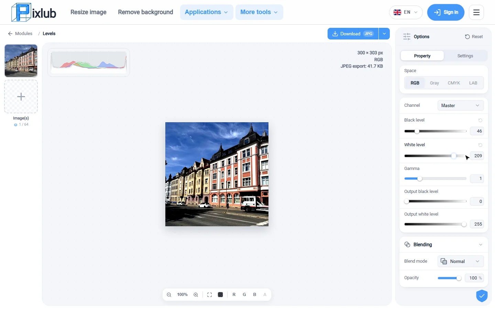

# Niveles

Ajustar los puntos negro y blanco, la gamma y el rango de salida, canal por canal.

**Categoría** : Ajuste · **Identificador** : `levels` · [Referencia de la API](./api.md)

## Dónde usarlo

- **[Página del módulo](https://pixlub.com/es/module/levels)** : Suelte sus archivos, ajuste y descargue: el módulo por sí solo, sin nada más.
- **[Grafo de imagen](https://pixlub.com/es/image/graph)** : Conéctelo a otros módulos para componer un efecto más complejo.

## Entradas

Los archivos que acepta la página del módulo: suéltelos en la zona de importación o haga clic en ella para buscarlos. Un archivo de otro formato se descarta, con un mensaje que recuerda los formatos permitidos.

| Entrada | Formatos aceptados | Archivos |
| --- | --- | --- |
| **Imagen(es)** (obligatoria) Imagen cuyos niveles se ajustan. | `PNG`, `JPEG`, `WebP`, `GIF`, `AVIF`, `BMP` | Uno o varios: cada imagen se procesa por separado, con los mismos ajustes |

El número de imágenes que se procesan a la vez depende de su plan.

Mediante la API, los archivos y sus formatos se detallan en la [vista API](./api.md).

## Presentación en video

▶ [Ver el video](../../../../assets/modules/levels/demo.en.mp4) : Puntos negro y blanco, gamma y luego un solo canal.

1. `0:00` Import an image
2. `0:02` Black and white points
3. `0:09` Midtone gamma
4. `0:13` One channel at a time
5. `0:20` Export the result

## Uso

1. **Importar**

   Suelte una o varias imágenes.

2. **Fijar el negro y el blanco**

   Suba el **nivel de negro** y baje el **nivel de blanco**: el contraste se abre.

3. **Afinar**

   La **gamma** aclara u oscurece los tonos medios. El menú **Canal** ajusta un color por separado.

## Ajustes

| Ajuste | Efecto |
| --- | --- |
| **Espacio** | RGB, Gris, CMYK o LAB. |
| **Canal** | Maestro (todos) o un canal del espacio. Todos los canales se aplican a la vez. |
| **Nivel de negro** / **de blanco** | 0 a 255. Lo más oscuro se vuelve negro y lo más claro, blanco. |
| **Gamma** | 0,1 a 4. Por debajo de 1 la imagen se oscurece y por encima se aclara. |
| **Niveles de salida** | Valores que toman el negro y el blanco: efecto lavado o apagado. |
| **Fusión** | Modo de fusión y opacidad: cómo se aplica el ajuste sobre la imagen original. |

## Consejos

- Un canal **Azul** o **Rojo** ajustado por separado corrige una dominante de color.
- Subir el negro de salida da un acabado mate, estilo película.

## Exportación

El botón **Descargar** guarda el resultado en el formato del archivo importado: una foto JPEG sale en JPEG. El menú a su derecha abre los **Ajustes de exportación** para elegir otro formato y ajustar la calidad, el tamaño o el fondo, y ofrece **Copiar la imagen**.

Con varias imágenes, el botón pasa a ser **Descargar en ZIP**; el menú también ofrece los archivos por separado o solo la imagen mostrada.

- **[La ventana de exportación](../../../../01-app/es/02-image/04-exportation.md)** : Todos los formatos, sus ajustes, el procesamiento local o en el servidor, los lotes y la carpeta local.
