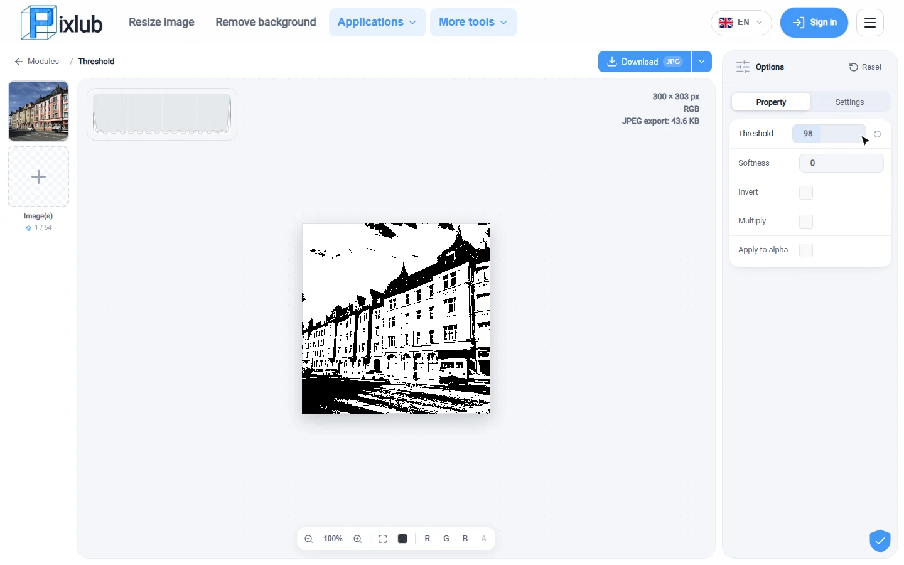

# Umbral

Pasar una imagen a blanco y negro puro según un umbral de luminosidad.

**Categoría** : Ajuste · **Identificador** : `threshold` · [Referencia de la API](./api.md)

## Dónde usarlo

- **[Página del módulo](https://pixlub.com/es/module/threshold)** : Suelte sus archivos, ajuste y descargue: el módulo por sí solo, sin nada más.
- **[Grafo de imagen](https://pixlub.com/es/image/graph)** : Conéctelo a otros módulos para componer un efecto más complejo.

## Entradas

Los archivos que acepta la página del módulo: suéltelos en la zona de importación o haga clic en ella para buscarlos. Un archivo de otro formato se descarta, con un mensaje que recuerda los formatos permitidos.

| Entrada | Formatos aceptados | Archivos |
| --- | --- | --- |
| **Imagen(es)** (obligatoria) Imagen binarizada según el umbral. | `PNG`, `JPEG`, `WebP`, `GIF`, `AVIF`, `BMP` | Uno o varios: cada imagen se procesa por separado, con los mismos ajustes |

El número de imágenes que se procesan a la vez depende de su plan.

Mediante la API, los archivos y sus formatos se detallan en la [vista API](./api.md).

## Presentación en video

▶ [Ver el video](../../../../assets/modules/threshold/demo.en.mp4) : Colocar el umbral, suavizar, invertir.

1. `0:00` Import an image
2. `0:03` Set the threshold
3. `0:06` Soften the transition
4. `0:09` Invert
5. `0:12` Export the result

## Uso

1. **Importar**

   Suelte una o varias imágenes.

2. **Colocar el umbral**

   Lo que es más claro se vuelve blanco y el resto, negro.

3. **Suavizar**

   El **suavizado** sustituye el corte neto por un fundido.

## Ajustes

| Ajuste | Efecto |
| --- | --- |
| **Umbral** | 0 a 255: luminosidad a partir de la cual un píxel se vuelve blanco. |
| **Suavizado** | 0 a 128: ancho de la transición. |
| **Invertir** | Intercambia el negro y el blanco. |
| **Multiplicar** | Multiplica el resultado en blanco y negro por la imagen original. |
| **Aplicar al alfa** | El umbral también se aplica a la transparencia. |

## Consejos

- Ideal para limpiar un documento escaneado o preparar un sello.
- En el [grafo de imagen](../../../../01-app/es/02-image/01-image-graph.md), el resultado sirve de máscara.

## Exportación

El botón **Descargar** guarda el resultado en el formato del archivo importado: una foto JPEG sale en JPEG. El menú a su derecha abre los **Ajustes de exportación** para elegir otro formato y ajustar la calidad, el tamaño o el fondo, y ofrece **Copiar la imagen**.

Con varias imágenes, el botón pasa a ser **Descargar en ZIP**; el menú también ofrece los archivos por separado o solo la imagen mostrada.

- **[La ventana de exportación](../../../../01-app/es/02-image/04-exportation.md)** : Todos los formatos, sus ajustes, el procesamiento local o en el servidor, los lotes y la carpeta local.
