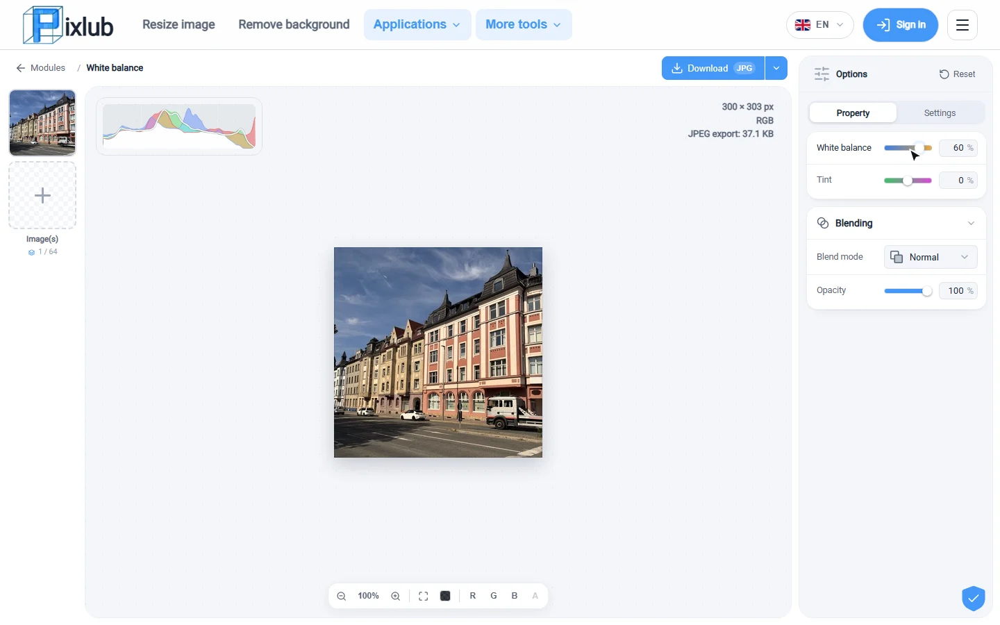

# Balance de blancos

Calentar o enfriar una imagen y corregir su dominante verde o magenta.

**Categoría** : Ajuste · **Identificador** : `whiteBalance` · [Referencia de la API](./api.md)

## Dónde usarlo

- **[Página del módulo](https://pixlub.com/es/module/whiteBalance)** : Suelte sus archivos, ajuste y descargue: el módulo por sí solo, sin nada más.
- **[Grafo de imagen](https://pixlub.com/es/image/graph)** : Conéctelo a otros módulos para componer un efecto más complejo.

## Entradas

Los archivos que acepta la página del módulo: suéltelos en la zona de importación o haga clic en ella para buscarlos. Un archivo de otro formato se descarta, con un mensaje que recuerda los formatos permitidos.

| Entrada | Formatos aceptados | Archivos |
| --- | --- | --- |
| **Imagen(es)** (obligatoria) Imagen cuyo balance de blancos se corrige. | `PNG`, `JPEG`, `WebP`, `GIF`, `AVIF`, `BMP` | Uno o varios: cada imagen se procesa por separado, con los mismos ajustes |

El número de imágenes que se procesan a la vez depende de su plan.

Mediante la API, los archivos y sus formatos se detallan en la [vista API](./api.md).

## Presentación en video

▶ [Ver el video](../../../../assets/modules/whiteBalance/demo.en.mp4) : Calentar, enfriar, corregir la dominante, dosificar.

1. `0:00` Import an image
2. `0:02` Warm up or cool down
3. `0:10` Fix the colour cast
4. `0:14` Dose it with the opacity
5. `0:22` Export the result

## Uso

1. **Importar**

   Suelte una o varias imágenes.

2. **Ajustar la temperatura**

   Hacia la derecha la imagen se calienta y hacia la izquierda se enfría.

3. **Corregir el matiz**

   Si la imagen tira a verde o a magenta.

## Ajustes

| Ajuste | Efecto |
| --- | --- |
| **Balance de blancos** | −100 (azul) a 100 (amarillo anaranjado). |
| **Matiz** | −100 (verde) a 100 (magenta). |
| **Fusión** | Modo de fusión y opacidad: cómo se aplica el ajuste sobre la imagen original. |

## Consejos

- Una foto tomada bajo una bombilla tira a amarillo: enfríela ligeramente.
- Para ajustar también la luz, [Ajuste básico](../baseAdjust/README.md) lo reúne todo.

## Exportación

El botón **Descargar** guarda el resultado en el formato del archivo importado: una foto JPEG sale en JPEG. El menú a su derecha abre los **Ajustes de exportación** para elegir otro formato y ajustar la calidad, el tamaño o el fondo, y ofrece **Copiar la imagen**.

Con varias imágenes, el botón pasa a ser **Descargar en ZIP**; el menú también ofrece los archivos por separado o solo la imagen mostrada.

- **[La ventana de exportación](../../../../01-app/es/02-image/04-exportation.md)** : Todos los formatos, sus ajustes, el procesamiento local o en el servidor, los lotes y la carpeta local.
