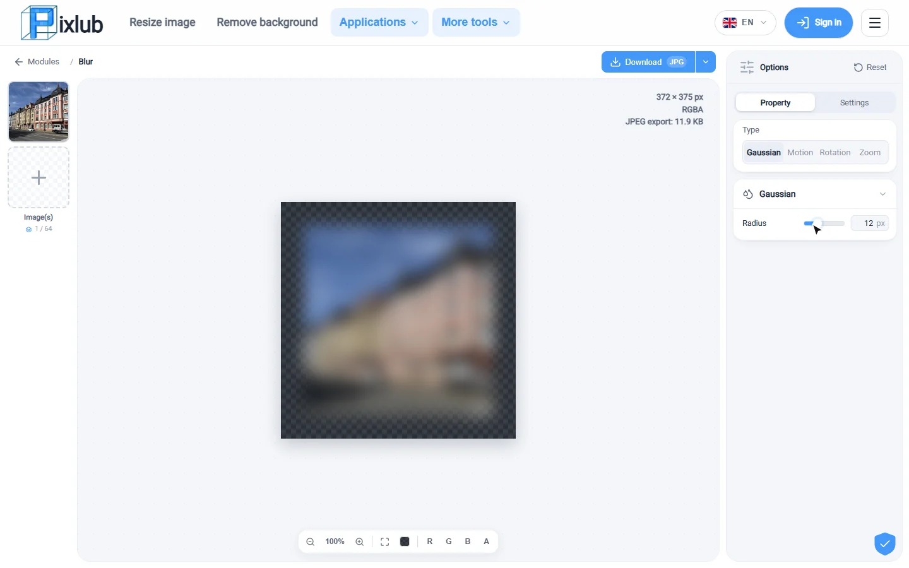

# Desenfoque

Desenfocar una imagen: gaussiano, de movimiento, de rotación o de zoom.

**Categoría** : Filtros · **Identificador** : `blur` · [Referencia de la API](./api.md)

## Dónde usarlo

- **[Página del módulo](https://pixlub.com/es/module/blur)** : Suelte sus archivos, ajuste y descargue: el módulo por sí solo, sin nada más.
- **[Grafo de imagen](https://pixlub.com/es/image/graph)** : Conéctelo a otros módulos para componer un efecto más complejo.

## Entradas

Los archivos que acepta la página del módulo: suéltelos en la zona de importación o haga clic en ella para buscarlos. Un archivo de otro formato se descarta, con un mensaje que recuerda los formatos permitidos.

| Entrada | Formatos aceptados | Archivos |
| --- | --- | --- |
| **Imagen(es)** (obligatoria) Imagen que se va a desenfocar. | `PNG`, `JPEG`, `WebP`, `GIF`, `AVIF`, `BMP` | Uno o varios: cada imagen se procesa por separado, con los mismos ajustes |

El número de imágenes que se procesan a la vez depende de su plan.

Mediante la API, los archivos y sus formatos se detallan en la [vista API](./api.md).

## Presentación en video

▶ [Ver el video](../../../../assets/modules/blur/demo.en.mp4) : Gaussiano, movimiento y luego zoom con su centro.

1. `0:00` Import an image
2. `0:02` Gaussian blur
3. `0:05` Motion blur
4. `0:11` Zoom, center placed
5. `0:15` Export the result

## Uso

1. **Importar**

   Suelte una o varias imágenes.

2. **Elegir el tipo**

   **Gaussiano**, **Movimiento**, **Rotación** o **Zoom**.

3. **Ajustar**

   Cada tipo tiene su ajuste. Para Rotación y Zoom, haga clic en la vista previa para colocar el centro.

## Ajustes

| Ajuste | Efecto |
| --- | --- |
| **Gaussiano** | Radio, 0 a 40 px: un desenfoque uniforme. |
| **Movimiento** | Ángulo y distancia (0 a 500 px): un barrido en una dirección. |
| **Rotación** | Ángulo de rotación, 0° a 90°, alrededor del centro. |
| **Zoom** | Intensidad, 0 a 100 %, desde el centro. |
| **Centro X** / **Y** | Posición del centro, en %. |

## Consejos

- Un radio gaussiano pequeño (1 a 3 px) suaviza la piel sin borrar los detalles.
- Para ocultar rostros, prefiera [Difuminado de rostros](../../08-api/faceBlurApi/README.md).

## Exportación

El botón **Descargar** guarda el resultado en el formato del archivo importado: una foto JPEG sale en JPEG. El menú a su derecha abre los **Ajustes de exportación** para elegir otro formato y ajustar la calidad, el tamaño o el fondo, y ofrece **Copiar la imagen**.

Con varias imágenes, el botón pasa a ser **Descargar en ZIP**; el menú también ofrece los archivos por separado o solo la imagen mostrada.

- **[La ventana de exportación](../../../../01-app/es/02-image/04-exportation.md)** : Todos los formatos, sus ajustes, el procesamiento local o en el servidor, los lotes y la carpeta local.
