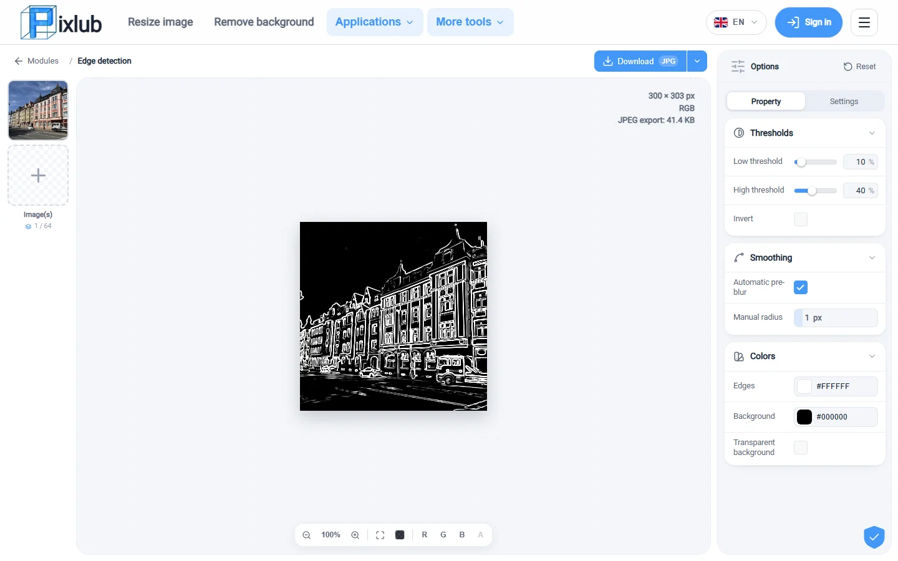

# Detección de contornos

Extraer los contornos de una imagen en forma de trazos.

**Categoría** : Filtros · **Identificador** : `edgeDetect` · [Referencia de la API](./api.md)

## Dónde usarlo

- **[Página del módulo](https://pixlub.com/es/module/edgeDetect)** : Suelte sus archivos, ajuste y descargue: el módulo por sí solo, sin nada más.
- **[Grafo de imagen](https://pixlub.com/es/image/graph)** : Conéctelo a otros módulos para componer un efecto más complejo.

## Entradas

Los archivos que acepta la página del módulo: suéltelos en la zona de importación o haga clic en ella para buscarlos. Un archivo de otro formato se descarta, con un mensaje que recuerda los formatos permitidos.

| Entrada | Formatos aceptados | Archivos |
| --- | --- | --- |
| **Imagen(es)** (obligatoria) Imagen cuyos contornos se extraen. | `PNG`, `JPEG`, `WebP`, `GIF`, `AVIF`, `BMP` | Uno o varios: cada imagen se procesa por separado, con los mismos ajustes |

El número de imágenes que se procesan a la vez depende de su plan.

Mediante la API, los archivos y sus formatos se detallan en la [vista API](./api.md).

## Presentación en video

▶ [Ver el video](../../../../assets/modules/edgeDetect/demo.en.mp4) : Umbrales, colores e inversión.

1. `0:00` Import an image
2. `0:03` Thresholds
3. `0:08` Colours and invert
4. `0:16` Export the result

## Uso

1. **Importar**

   Suelte una o varias imágenes: los contornos aparecen sobre fondo negro.

2. **Ajustar los umbrales**

   Bájelos para obtener más trazos, o súbalos para conservar solo los bordes marcados.

3. **Colorear**

   Color de los trazos y del fondo, o fondo transparente.

## Ajustes

| Ajuste | Efecto |
| --- | --- |
| **Umbral bajo** / **alto** | 0 a 100 %: qué bordes se conservan. |
| **Invertir** | Trazos oscuros sobre fondo claro. |
| **Desenfoque previo automático** / **Radio manual** | Suaviza la imagen antes de la detección para reducir el ruido. |
| **Contornos** / **Fondo** | Colores de los trazos y del fondo. |
| **Fondo transparente** | Solo conserva los trazos. |

## Consejos

- Invertido, sobre fondo blanco, el resultado parece un dibujo de línea.
- Con un fondo transparente, superponga los trazos a la imagen original en el [grafo de imagen](../../../../01-app/es/02-image/01-image-graph.md).

## Exportación

El botón **Descargar** guarda el resultado en el formato del archivo importado: una foto JPEG sale en JPEG. El menú a su derecha abre los **Ajustes de exportación** para elegir otro formato y ajustar la calidad, el tamaño o el fondo, y ofrece **Copiar la imagen**.

Con varias imágenes, el botón pasa a ser **Descargar en ZIP**; el menú también ofrece los archivos por separado o solo la imagen mostrada.

- **[La ventana de exportación](../../../../01-app/es/02-image/04-exportation.md)** : Todos los formatos, sus ajustes, el procesamiento local o en el servidor, los lotes y la carpeta local.
