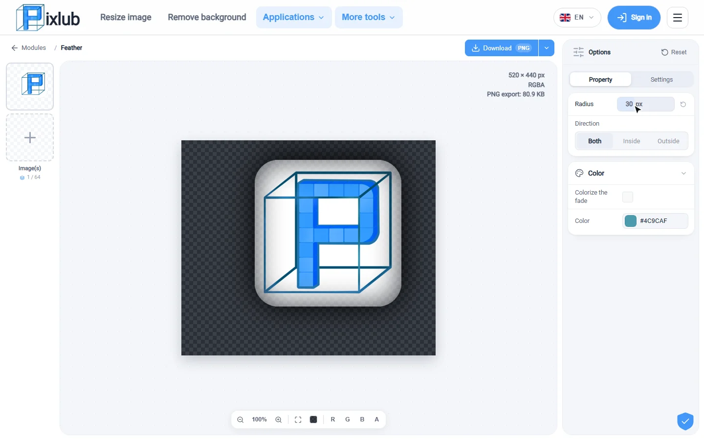

# Borde difuminado

Suavizar los bordes de la transparencia de una imagen.

**Categoría** : Filtros · **Identificador** : `feather` · [Referencia de la API](./api.md)

## Dónde usarlo

- **[Página del módulo](https://pixlub.com/es/module/feather)** : Suelte sus archivos, ajuste y descargue: el módulo por sí solo, sin nada más.
- **[Grafo de imagen](https://pixlub.com/es/image/graph)** : Conéctelo a otros módulos para componer un efecto más complejo.

## Entradas

Los archivos que acepta la página del módulo: suéltelos en la zona de importación o haga clic en ella para buscarlos. Un archivo de otro formato se descarta, con un mensaje que recuerda los formatos permitidos.

| Entrada | Formatos aceptados | Archivos |
| --- | --- | --- |
| **Imagen(es)** (obligatoria) Imagen cuyos bordes de transparencia se suavizan. | `PNG`, `JPEG`, `WebP`, `GIF`, `AVIF`, `BMP` | Uno o varios: cada imagen se procesa por separado, con los mismos ajustes |

El número de imágenes que se procesan a la vez depende de su plan.

Mediante la API, los archivos y sus formatos se detallan en la [vista API](./api.md).

## Presentación en video

▶ [Ver el video](../../../../assets/modules/feather/demo.en.mp4) : Radio, dirección y luego fundido de color.

1. `0:00` Import a cut-out image
2. `0:02` Fade radius
3. `0:05` Direction
4. `0:07` Colourize the fade
5. `0:08` Export the result

## Uso

1. **Importar**

   Suelte una imagen con transparencia.

2. **Ajustar el fundido**

   El **radio** fija su ancho y la **dirección**, su lado.

## Ajustes

| Ajuste | Efecto |
| --- | --- |
| **Radio** | 1 a 100 px. |
| **Dirección** | Ambos, interior o exterior. |
| **Colorear el fundido** | Tiñe el borde suavizado con el **color** elegido. |

## Consejos

- Un recorte demasiado nítido se integra mejor en un nuevo fondo con 2 a 4 px de fundido.

## Exportación

El botón **Descargar** guarda el resultado en el formato del archivo importado: una foto JPEG sale en JPEG. El menú a su derecha abre los **Ajustes de exportación** para elegir otro formato y ajustar la calidad, el tamaño o el fondo, y ofrece **Copiar la imagen**.

Con varias imágenes, el botón pasa a ser **Descargar en ZIP**; el menú también ofrece los archivos por separado o solo la imagen mostrada.

- **[La ventana de exportación](../../../../01-app/es/02-image/04-exportation.md)** : Todos los formatos, sus ajustes, el procesamiento local o en el servidor, los lotes y la carpeta local.
