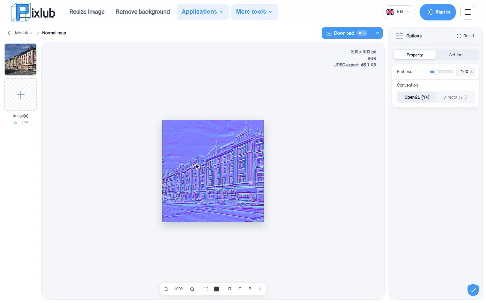

# Mapa de normales

Crear un mapa de normales (normal map) a partir de un mapa de alturas, para el 3D.

**Categoría** : Filtros · **Identificador** : `normalMap` · [Referencia de la API](./api.md)

## Dónde usarlo

- **[Página del módulo](https://pixlub.com/es/module/normalMap)** : Suelte sus archivos, ajuste y descargue: el módulo por sí solo, sin nada más.
- **[Grafo de imagen](https://pixlub.com/es/image/graph)** : Conéctelo a otros módulos para componer un efecto más complejo.

## Entradas

Los archivos que acepta la página del módulo: suéltelos en la zona de importación o haga clic en ella para buscarlos. Un archivo de otro formato se descarta, con un mensaje que recuerda los formatos permitidos.

| Entrada | Formatos aceptados | Archivos |
| --- | --- | --- |
| **Imagen(es)** (obligatoria) Mapa de alturas (heightmap) en escala de grises: lo claro es alto y lo oscuro, bajo. | `PNG`, `JPEG`, `WebP`, `GIF`, `AVIF`, `BMP` | Uno o varios: cada imagen se procesa por separado, con los mismos ajustes |

El número de imágenes que se procesan a la vez depende de su plan.

Mediante la API, los archivos y sus formatos se detallan en la [vista API](./api.md).

## Presentación en video

▶ [Ver el video](../../../../assets/modules/normalMap/demo.en.mp4) : Relieve y luego convención OpenGL o DirectX.

1. `0:00` Import a height map
2. `0:03` Emboss
3. `0:07` OpenGL or DirectX convention
4. `0:08` Export the result

## Uso

1. **Importar**

   Suelte un mapa de alturas: lo claro está arriba y lo oscuro, abajo.

2. **Dosificar el relieve**

   Cuanto más fuerte, más se acentúan las pendientes.

3. **Elegir la convención**

   La de su motor 3D.

## Ajustes

| Ajuste | Efecto |
| --- | --- |
| **Relieve** | 1 a 400 %. |
| **Convención** | **OpenGL (Y+)**: Blender, Unity, Godot. **DirectX (Y−)**: Unreal, 3ds Max. |

## Consejos

- Exporte en PNG: la compresión JPEG estropea las normales.
- Una foto pasada a [Blanco y negro](../../04-adjust/blackWhite/README.md) sirve como mapa de alturas rápido.

## Exportación

El botón **Descargar** guarda el resultado en el formato del archivo importado: una foto JPEG sale en JPEG. El menú a su derecha abre los **Ajustes de exportación** para elegir otro formato y ajustar la calidad, el tamaño o el fondo, y ofrece **Copiar la imagen**.

Con varias imágenes, el botón pasa a ser **Descargar en ZIP**; el menú también ofrece los archivos por separado o solo la imagen mostrada.

- **[La ventana de exportación](../../../../01-app/es/02-image/04-exportation.md)** : Todos los formatos, sus ajustes, el procesamiento local o en el servidor, los lotes y la carpeta local.
