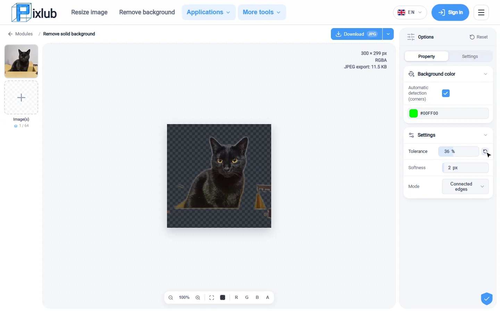

# Quitar un fondo liso

Volver transparente un fondo de un solo color: pantalla verde, estudio, pared.

**Categoría** : Filtros · **Identificador** : `removeBg` · [Referencia de la API](./api.md)

## Dónde usarlo

- **[Página del módulo](https://pixlub.com/es/module/removeBg)** : Suelte sus archivos, ajuste y descargue: el módulo por sí solo, sin nada más.
- **[Grafo de imagen](https://pixlub.com/es/image/graph)** : Conéctelo a otros módulos para componer un efecto más complejo.

## Entradas

Los archivos que acepta la página del módulo: suéltelos en la zona de importación o haga clic en ella para buscarlos. Un archivo de otro formato se descarta, con un mensaje que recuerda los formatos permitidos.

| Entrada | Formatos aceptados | Archivos |
| --- | --- | --- |
| **Imagen(es)** (obligatoria) Imagen cuyo fondo liso se vuelve transparente. | `PNG`, `JPEG`, `WebP`, `GIF`, `AVIF`, `BMP` | Uno o varios: cada imagen se procesa por separado, con los mismos ajustes |

El número de imágenes que se procesan a la vez depende de su plan.

Mediante la API, los archivos y sus formatos se detallan en la [vista API](./api.md).

## Presentación en video

▶ [Ver el video](../../../../assets/modules/removeBg/demo.en.mp4) : Fondo detectado, tolerancia, borde suavizado, modo.

1. `0:00` Import an image on a plain background
2. `0:03` Background detected from the corners
3. `0:06` Soften the edge
4. `0:08` Detection mode
5. `0:16` Export the result

## Uso

1. **Importar**

   Suelte una imagen sobre fondo liso: el color del fondo se lee en las esquinas.

2. **Ajustar la tolerancia**

   Súbala hasta que desaparezca todo el fondo.

3. **Afinar**

   Suavice el borde; desmarque la detección para elegir usted mismo el color.

## Ajustes

| Ajuste | Efecto |
| --- | --- |
| **Detección automática** | Color del fondo tomado de las esquinas; si no, el **color** elegido. |
| **Tolerancia** | 0 a 100 %: matices que se van con el fondo. |
| **Suavizado** | 0 a 50 px de borde progresivo. |
| **Modo** | **Bordes conectados**: solo el fondo conectado a los bordes. **Toda la imagen**: en todas partes. |

## Retocar con el borrador

- El botón **Borrador** de la vista previa lo activa: sus opciones flotan sobre la imagen.
- Pinte para quitar lo que quede; **Restaurar** (o **Alt**) recupera lo que el recorte se llevó.
- **Zonas borradas en rojo** muestra todo lo que se ha quitado.

## Consejos

- Todo se hace en el navegador, sin créditos. Para un fondo complejo, use [Quitar el fondo](../../08-api/removeBgApi/README.md).
- Exporte en PNG o WebP para conservar la transparencia.

## Exportación

El botón **Descargar** guarda el resultado en el formato del archivo importado: una foto JPEG sale en JPEG. El menú a su derecha abre los **Ajustes de exportación** para elegir otro formato y ajustar la calidad, el tamaño o el fondo, y ofrece **Copiar la imagen**.

Con varias imágenes, el botón pasa a ser **Descargar en ZIP**; el menú también ofrece los archivos por separado o solo la imagen mostrada.

- **[La ventana de exportación](../../../../01-app/es/02-image/04-exportation.md)** : Todos los formatos, sus ajustes, el procesamiento local o en el servidor, los lotes y la carpeta local.
