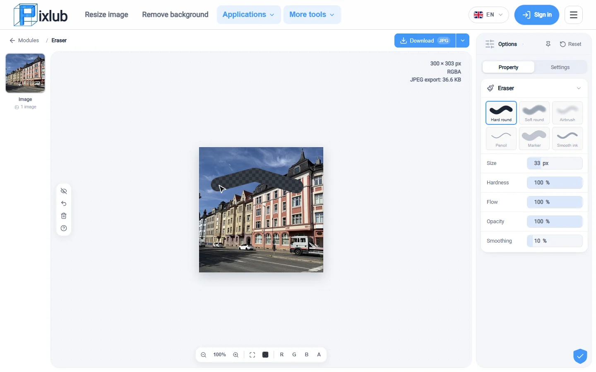

# Borrador

Borrar a mano partes de una imagen, con una paleta de puntas.

**Categoría** : Composición · **Identificador** : `eraser` · [Referencia de la API](./api.md)

## Dónde usarlo

- **[Página del módulo](https://pixlub.com/es/module/eraser)** : Suelte sus archivos, ajuste y descargue: el módulo por sí solo, sin nada más.
- **[Grafo de imagen](https://pixlub.com/es/image/graph)** : Conéctelo a otros módulos para componer un efecto más complejo.

## Entradas

Los archivos que acepta la página del módulo: suéltelos en la zona de importación o haga clic en ella para buscarlos. Un archivo de otro formato se descarta, con un mensaje que recuerda los formatos permitidos.

| Entrada | Formatos aceptados | Archivos |
| --- | --- | --- |
| **Imagen** (obligatoria) Imagen que se va a borrar. | `PNG`, `JPEG`, `WebP`, `GIF`, `AVIF`, `BMP` | Un archivo |

Mediante la API, los archivos y sus formatos se detallan en la [vista API](./api.md).

## Presentación en video

▶ [Ver el video](../../../../assets/modules/eraser/demo.en.mp4) : Punta dura, punta suave, dureza y opacidad.

1. `0:00` Import an image
2. `0:03` Erase with the hard tip
3. `0:11` Soften the edge with the soft tip
4. `0:15` Hardness and opacity
5. `0:24` Export the result

## Uso

1. **Importar**

   Suelte la imagen que quiere borrar.

2. **Elegir una punta**

   Tome un pincel de la paleta y luego ajuste su tamaño y su dureza.

3. **Borrar**

   Pinte en la vista previa: lo que toca el borrador se vuelve transparente. **Zonas borradas en rojo** muestra lo que se quita.

## Ajustes

| Ajuste | Efecto |
| --- | --- |
| **Borrar / Restaurar** | Quitar, o recuperar una parte ya borrada (**Alt** invierte el modo durante un trazo). |
| **Pinceles** | Redondo duro, redondo suave, aerógrafo, lápiz, marcador, tinta suavizada: lo ajusta todo de una vez. |
| **Tamaño** | Diámetro de la punta, en píxeles de la imagen. |
| **Dureza** | 100 %: borde nítido. 0 %: borde difuminado. |
| **Flujo** | Si es bajo, el trazo se refuerza donde se vuelve a pasar. |
| **Opacidad** | Límite de un trazo: al 50 %, solo quita la mitad. |
| **Suavizar** | El trazo sigue la mano con un ligero retraso, más regular. |

Cada trazo conserva la punta con la que se trazó: cambiar el tamaño solo afecta a los trazos siguientes.

## Consejos

- **Ctrl + Z** o «Quitar el último trazo» deshace un trazo; la papelera los borra todos.
- Exporte en **PNG** o **WebP**: el JPEG no conserva la transparencia.

## Exportación

El botón **Descargar** guarda el resultado en el formato del archivo importado: una foto JPEG sale en JPEG. El menú a su derecha abre los **Ajustes de exportación** para elegir otro formato y ajustar la calidad, el tamaño o el fondo, y ofrece **Copiar la imagen**.

- **[La ventana de exportación](../../../../01-app/es/02-image/04-exportation.md)** : Todos los formatos, sus ajustes, el procesamiento local o en el servidor, los lotes y la carpeta local.
