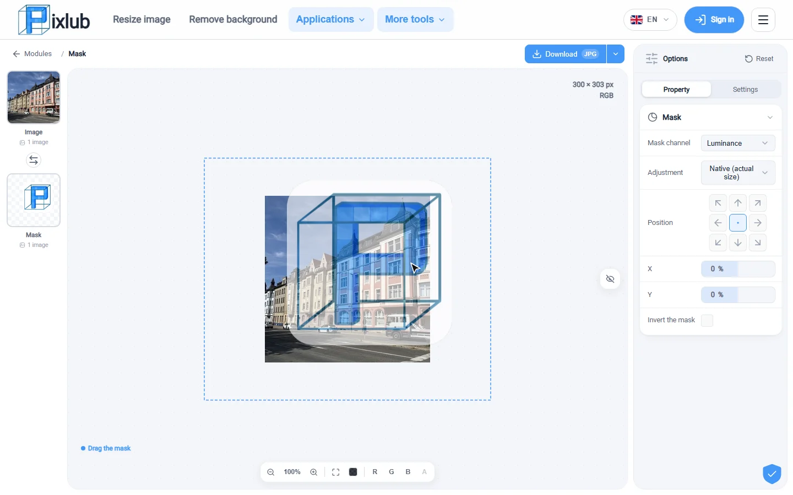

# Máscara

Hacer transparente una imagen allí donde una máscara es negra.

**Categoría** : Composición · **Identificador** : `mask` · [Referencia de la API](./api.md)

## Dónde usarlo

- **[Página del módulo](https://pixlub.com/es/module/mask)** : Suelte sus archivos, ajuste y descargue: el módulo por sí solo, sin nada más.
- **[Grafo de imagen](https://pixlub.com/es/image/graph)** : Conéctelo a otros módulos para componer un efecto más complejo.

## Entradas

Los archivos que acepta la página del módulo: suéltelos en la zona de importación o haga clic en ella para buscarlos. Un archivo de otro formato se descarta, con un mensaje que recuerda los formatos permitidos.

| Entrada | Formatos aceptados | Archivos |
| --- | --- | --- |
| **Imagen** (obligatoria) Imagen cuya opacidad se modula. | `PNG`, `JPEG`, `WebP`, `GIF`, `AVIF`, `BMP` | Un archivo |
| **Máscara** (obligatoria) Máscara: su luminancia (o su alfa) fija la opacidad de la imagen, blanco = visible, negro = transparente. | `PNG`, `JPEG`, `WebP`, `GIF`, `AVIF`, `BMP` | Un archivo |

Mediante la API, los archivos y sus formatos se detallan en la [vista API](./api.md).

## Presentación en video

▶ [Ver el video](../../../../assets/modules/mask/demo.en.mp4) : Imagen y máscara, canal, ajuste y posición, inversión.

1. `0:00` Import the image and the mask
2. `0:05` Mask channel
3. `0:09` Fit and position
4. `0:14` Invert the mask
5. `0:16` Export the result

## Uso

1. **Importar**

   La **imagen** en la primera casilla y la **máscara** en la segunda.

2. **Elegir el canal**

   La **luminancia** de la máscara (blanco = visible) o su **alfa**.

3. **Ajustar la máscara**

   Ajuste (nativo, contener, cubrir, estirar), posición y desplazamiento.

## Ajustes

| Ajuste | Efecto |
| --- | --- |
| **Canal de la máscara** | Luminancia o alfa. |
| **Ajuste** | Tamaño real, contener, cubrir o estirar. |
| **Posición** / **X** / **Y** | Lugar de la máscara sobre la imagen. |
| **Invertir la máscara** | Lo que era visible se vuelve transparente. |

## Consejos

- Cree una máscara con [Dibujar una máscara](../../07-generate/drawShape/README.md) o [Imagen a máscara](../imageToMask/README.md).

## Exportación

El botón **Descargar** guarda el resultado en el formato del archivo importado: una foto JPEG sale en JPEG. El menú a su derecha abre los **Ajustes de exportación** para elegir otro formato y ajustar la calidad, el tamaño o el fondo, y ofrece **Copiar la imagen**.

- **[La ventana de exportación](../../../../01-app/es/02-image/04-exportation.md)** : Todos los formatos, sus ajustes, el procesamiento local o en el servidor, los lotes y la carpeta local.
