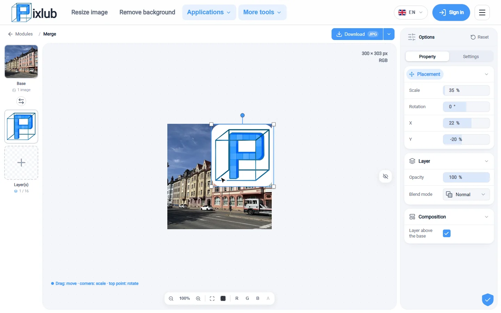

# Fusión

Superponer una o varias capas sobre una imagen de fondo.

**Categoría** : Composición · **Identificador** : `merge` · [Referencia de la API](./api.md)

## Dónde usarlo

- **[Página del módulo](https://pixlub.com/es/module/merge)** : Suelte sus archivos, ajuste y descargue: el módulo por sí solo, sin nada más.
- **[Grafo de imagen](https://pixlub.com/es/image/graph)** : Conéctelo a otros módulos para componer un efecto más complejo.

## Entradas

Los archivos que acepta la página del módulo: suéltelos en la zona de importación o haga clic en ella para buscarlos. Un archivo de otro formato se descarta, con un mensaje que recuerda los formatos permitidos.

| Entrada | Formatos aceptados | Archivos |
| --- | --- | --- |
| **Base** (obligatoria) Imagen de fondo sobre la que se colocan las capas. | `PNG`, `JPEG`, `WebP`, `GIF`, `AVIF`, `BMP` | Un archivo |
| **Capa(s)** (obligatoria) Capa o lote de capas superpuestas a la base, en orden. | `PNG`, `JPEG`, `WebP`, `GIF`, `AVIF`, `BMP` | Hasta 16 archivos, reunidos en un lote |

Mediante la API, los archivos y sus formatos se detallan en la [vista API](./api.md).

## Presentación en video

▶ [Ver el video](../../../../assets/modules/merge/demo.en.mp4) : Base y capa, escala, colocación con el mouse, opacidad y modo de fusión.

1. `0:00` Import the base and the layer
2. `0:05` Scale the layer
3. `0:08` Place it with the mouse
4. `0:12` Opacity and blend mode
5. `0:19` Export the result

## Uso

1. **Importar**

   La **base** en la primera casilla y la capa o las **capas** en la segunda.

2. **Colocar la capa**

   En la vista previa: arrastre para mover, tire de una esquina para la escala y del punto superior para girar.

3. **Mezclar**

   **Opacidad** y **modo de fusión** de la capa.

## Ajustes

| Ajuste | Efecto |
| --- | --- |
| **Colocación** | Escala, rotación y desplazamiento X / Y de la capa. |
| **Opacidad** / **Modo de fusión** | Cómo se aplica la capa sobre la base. |
| **Capa por encima de la base** | Desmarcado, la base cubre la capa. |
| **Capas** | Con varias capas: una lista, cada una con su colocación y su fusión. |

## Consejos

- Un logotipo en PNG recortado, reducido y colocado en una esquina: una marca de agua en unos segundos.

## Exportación

El botón **Descargar** guarda el resultado en el formato del archivo importado: una foto JPEG sale en JPEG. El menú a su derecha abre los **Ajustes de exportación** para elegir otro formato y ajustar la calidad, el tamaño o el fondo, y ofrece **Copiar la imagen**.

Con varias imágenes, el botón pasa a ser **Descargar en ZIP**; el menú también ofrece los archivos por separado o solo la imagen mostrada.

- **[La ventana de exportación](../../../../01-app/es/02-image/04-exportation.md)** : Todos los formatos, sus ajustes, el procesamiento local o en el servidor, los lotes y la carpeta local.
