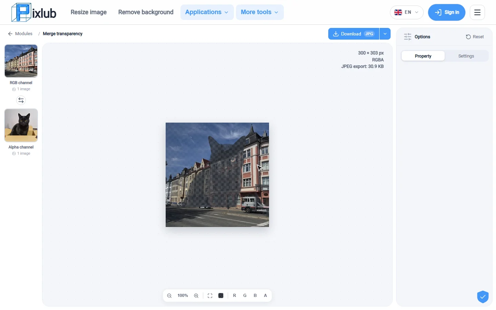

# Combinar transparencia

Recomponer una imagen transparente a partir de sus colores y de una máscara de transparencia.

**Categoría** : Composición · **Identificador** : `mergeAlpha` · [Referencia de la API](./api.md)

## Dónde usarlo

- **[Página del módulo](https://pixlub.com/es/module/mergeAlpha)** : Suelte sus archivos, ajuste y descargue: el módulo por sí solo, sin nada más.
- **[Grafo de imagen](https://pixlub.com/es/image/graph)** : Conéctelo a otros módulos para componer un efecto más complejo.

## Entradas

Los archivos que acepta la página del módulo: suéltelos en la zona de importación o haga clic en ella para buscarlos. Un archivo de otro formato se descarta, con un mensaje que recuerda los formatos permitidos.

| Entrada | Formatos aceptados | Archivos |
| --- | --- | --- |
| **Canal RGB** (obligatoria) Imagen cuyos colores (RGB) se conservan. | `PNG`, `JPEG`, `WebP`, `GIF`, `AVIF`, `BMP` | Un archivo |
| **Canal alfa** (obligatoria) Imagen en escala de grises que se convierte en la transparencia del resultado, blanco = opaco. | `PNG`, `JPEG`, `WebP`, `GIF`, `AVIF`, `BMP` | Un archivo |

Mediante la API, los archivos y sus formatos se detallan en la [vista API](./api.md).

## Presentación en video

▶ [Ver el video](../../../../assets/modules/mergeAlpha/demo.en.mp4) : Los colores y luego la máscara que se convierte en la transparencia.

1. `0:00` Import both images
2. `0:02` The second one becomes the transparency
3. `0:05` Export the result

## Uso

1. **Importar los colores**

   Primera casilla: la imagen cuyos colores se conservan.

2. **Importar la transparencia**

   Segunda casilla: una imagen en escala de grises. Blanco = opaco, negro = transparente.

## Consejos

- Útil para volver a montar una imagen tras haber procesado por separado su color y su alfa.
- Exporte en PNG o WebP para conservar la transparencia.

## Exportación

El botón **Descargar** guarda el resultado en el formato del archivo importado: una foto JPEG sale en JPEG. El menú a su derecha abre los **Ajustes de exportación** para elegir otro formato y ajustar la calidad, el tamaño o el fondo, y ofrece **Copiar la imagen**.

- **[La ventana de exportación](../../../../01-app/es/02-image/04-exportation.md)** : Todos los formatos, sus ajustes, el procesamiento local o en el servidor, los lotes y la carpeta local.
