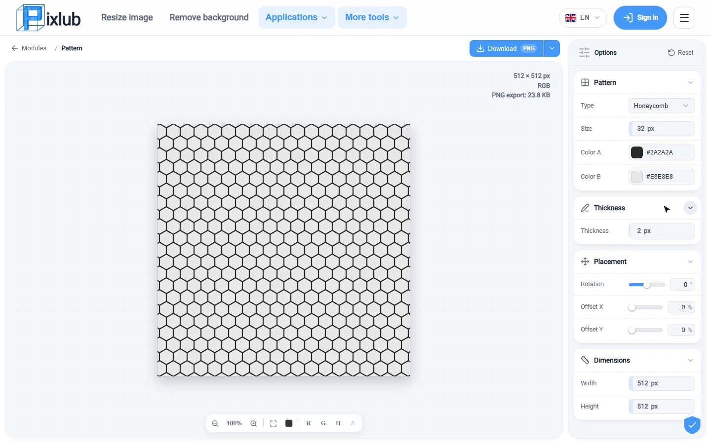

# Motivo

Generar un motivo repetido: tablero de ajedrez, cuadrícula, puntos, rayas, ladrillos, panal.

**Categoría** : Generación · **Identificador** : `checker`

## Dónde usarlo

- **[Página del módulo](https://pixlub.com/es/module/checker)** : Suelte sus archivos, ajuste y descargue: el módulo por sí solo, sin nada más.
- **[Grafo de imagen](https://pixlub.com/es/image/graph)** : Conéctelo a otros módulos para componer un efecto más complejo.

## Entradas

Este módulo no tiene entrada: crea la imagen solo a partir de sus ajustes.

## Presentación en video

▶ [Ver el video](../../../../assets/modules/checker/demo.en.mp4) : Ladrillos y luego panal, tamaño, color, rotación.

1. `0:00` The render shows right away
2. `0:01` Pick the pattern
3. `0:08` Size and colours
4. `0:17` Rotation
5. `0:20` Export the result

## Uso

1. **Elegir el motivo**

   Tablero de ajedrez, cuadrícula, puntos, rayas, ladrillos o panal.

2. **Ajustar**

   **Tamaño**, **colores A y B**, grosor o ancho de franja según el motivo.

3. **Colocar**

   Rotación y desplazamiento.

## Ajustes

| Ajuste | Efecto |
| --- | --- |
| **Tipo** | El motivo repetido. |
| **Tamaño** | 4 a 512 px. |
| **Color A** / **B** | Los dos colores. |
| **Grosor** | Cuadrícula, puntos, ladrillos, panal. |
| **Ancho de franja** / **Suavidad** | Rayas. |
| **Rotación** / **Desplazamiento** | Orientación y posición del motivo. |
| **Dimensiones** | Tamaño de la imagen. |

## Consejos

- Unas rayas suaves de bajo contraste son un fondo discreto para una presentación.

## Exportación

El botón **Descargar** guarda el resultado en el formato del archivo importado: una foto JPEG sale en JPEG. El menú a su derecha abre los **Ajustes de exportación** para elegir otro formato y ajustar la calidad, el tamaño o el fondo, y ofrece **Copiar la imagen**.

- **[La ventana de exportación](../../../../01-app/es/02-image/04-exportation.md)** : Todos los formatos, sus ajustes, el procesamiento local o en el servidor, los lotes y la carpeta local.
