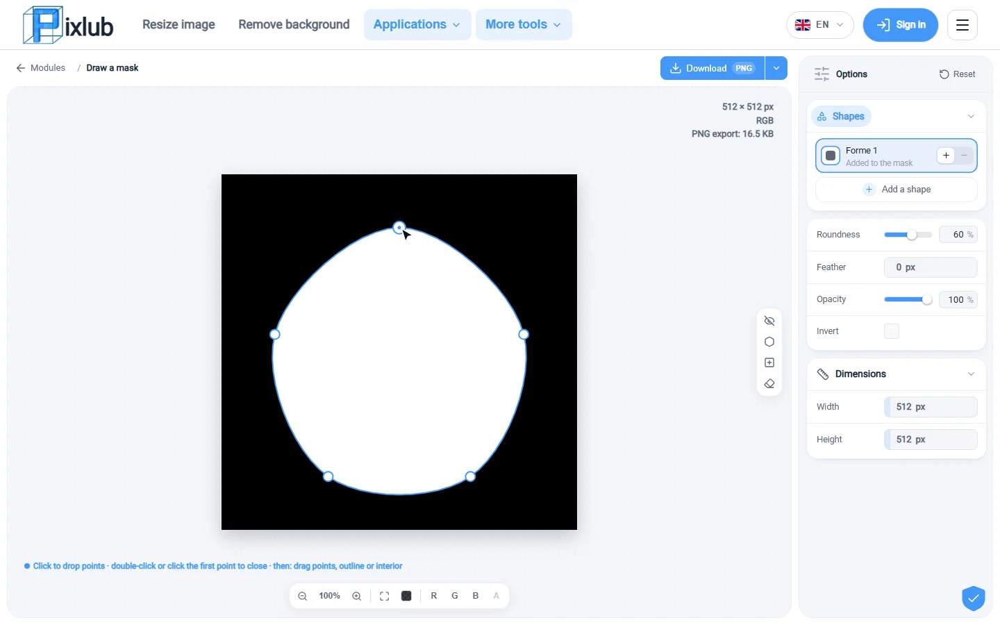

# Dibujar una máscara

Dibujar formas punto por punto, para sumar o restar, y obtener una máscara.

**Categoría** : Generación · **Identificador** : `drawShape`

## Dónde usarlo

- **[Página del módulo](https://pixlub.com/es/module/drawShape)** : Suelte sus archivos, ajuste y descargue: el módulo por sí solo, sin nada más.
- **[Grafo de imagen](https://pixlub.com/es/image/graph)** : Conéctelo a otros módulos para componer un efecto más complejo.

## Entradas

Este módulo no tiene entrada: crea la imagen solo a partir de sus ajustes.

## Presentación en video

▶ [Ver el video](../../../../assets/modules/drawShape/demo.en.mp4) : Colocar los puntos, redondear, suavizar, invertir.

1. `0:00` The render shows right away
2. `0:01` Place the points
3. `0:09` Roundness and feather
4. `0:14` Invert the mask
5. `0:16` Export the result

## Uso

1. **Colocar los puntos**

   Haga clic en la vista previa para cada vértice; un clic en el primer punto cierra la forma.

2. **Ajustar**

   Arrastre un punto, el contorno o el interior. La lista **Formas** añade otras, en suma o en resta.

3. **Suavizar**

   **Redondeo**, **borde difuminado** y **opacidad**.

## Ajustes

| Ajuste | Efecto |
| --- | --- |
| **Formas** | Lista de formas, cada una en suma o en resta. |
| **Redondeo** | 0 a 100 %: curvatura de los vértices. |
| **Borde difuminado** | 0 a 200 px de borde suavizado. |
| **Opacidad** / **Invertir** | Densidad de la máscara, y blanco ↔ negro. |
| **Dimensiones** | Tamaño de la máscara. |

## Consejos

- La máscara sirve en el [grafo de imagen](../../../../01-app/es/02-image/01-image-graph.md) para limitar un efecto a una zona.
- Un doble clic en un punto lo quita.

## Exportación

El botón **Descargar** guarda el resultado en el formato del archivo importado: una foto JPEG sale en JPEG. El menú a su derecha abre los **Ajustes de exportación** para elegir otro formato y ajustar la calidad, el tamaño o el fondo, y ofrece **Copiar la imagen**.

- **[La ventana de exportación](../../../../01-app/es/02-image/04-exportation.md)** : Todos los formatos, sus ajustes, el procesamiento local o en el servidor, los lotes y la carpeta local.
