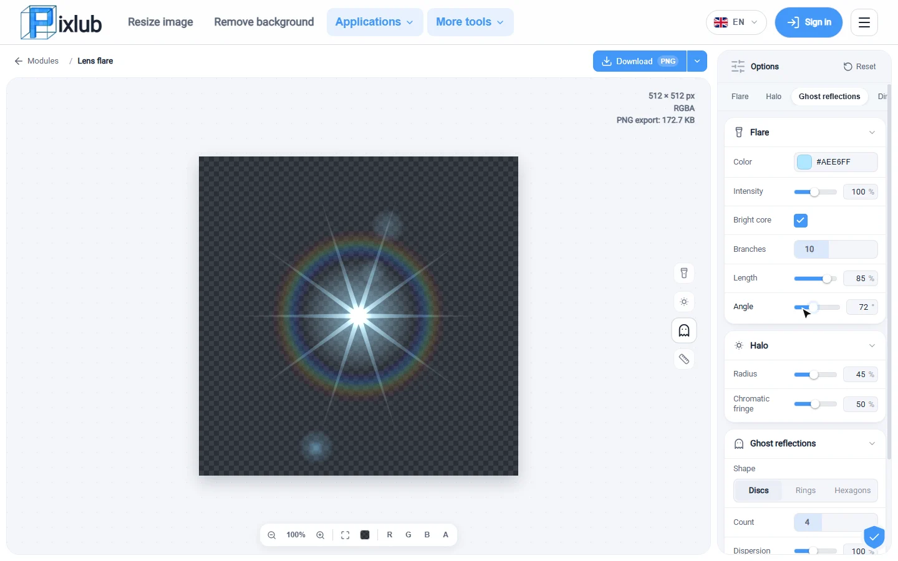

# Destello de lente

Generar un destello de objetivo: núcleo, ramas en estrella, halo y reflejos.

**Categoría** : Generación · **Identificador** : `flare`

## Dónde usarlo

- **[Página del módulo](https://pixlub.com/es/module/flare)** : Suelte sus archivos, ajuste y descargue: el módulo por sí solo, sin nada más.
- **[Grafo de imagen](https://pixlub.com/es/image/graph)** : Conéctelo a otros módulos para componer un efecto más complejo.

## Entradas

Este módulo no tiene entrada: crea la imagen solo a partir de sus ajustes.

## Presentación en video

▶ [Ver el video](../../../../assets/modules/flare/demo.en.mp4) : Ramas, halo y franja, reflejos fantasma.

1. `0:00` The render shows right away
2. `0:01` Star branches
3. `0:07` Halo and fringe
4. `0:14` Ghost reflections
5. `0:18` Export the result

## Uso

1. **Abrir**

   El destello se muestra sobre fondo transparente.

2. **Ajustar la estrella**

   Número de **ramas**, longitud y ángulo.

3. **Añadir halo y reflejos**

   Radio del halo, franja de color, forma y número de reflejos.

## Ajustes

| Ajuste | Efecto |
| --- | --- |
| **Color** / **Intensidad** | Tono y fuerza del destello. |
| **Núcleo luminoso** | Punto blanco en el centro. |
| **Ramas** / **Longitud** / **Ángulo** | La estrella. |
| **Halo** / **Franja cromática** | Anillo de color alrededor del núcleo. |
| **Reflejos fantasma** | Discos, anillos o hexágonos: número, dispersión, opacidad. |
| **Tamaño** | 64 a 4000 px. |

## Consejos

- Coloque el destello sobre una foto en el [grafo de imagen](../../../../01-app/es/02-image/01-image-graph.md) con la fusión **Trama**.

## Exportación

El botón **Descargar** guarda el resultado en el formato del archivo importado: una foto JPEG sale en JPEG. El menú a su derecha abre los **Ajustes de exportación** para elegir otro formato y ajustar la calidad, el tamaño o el fondo, y ofrece **Copiar la imagen**.

- **[La ventana de exportación](../../../../01-app/es/02-image/04-exportation.md)** : Todos los formatos, sus ajustes, el procesamiento local o en el servidor, los lotes y la carpeta local.
