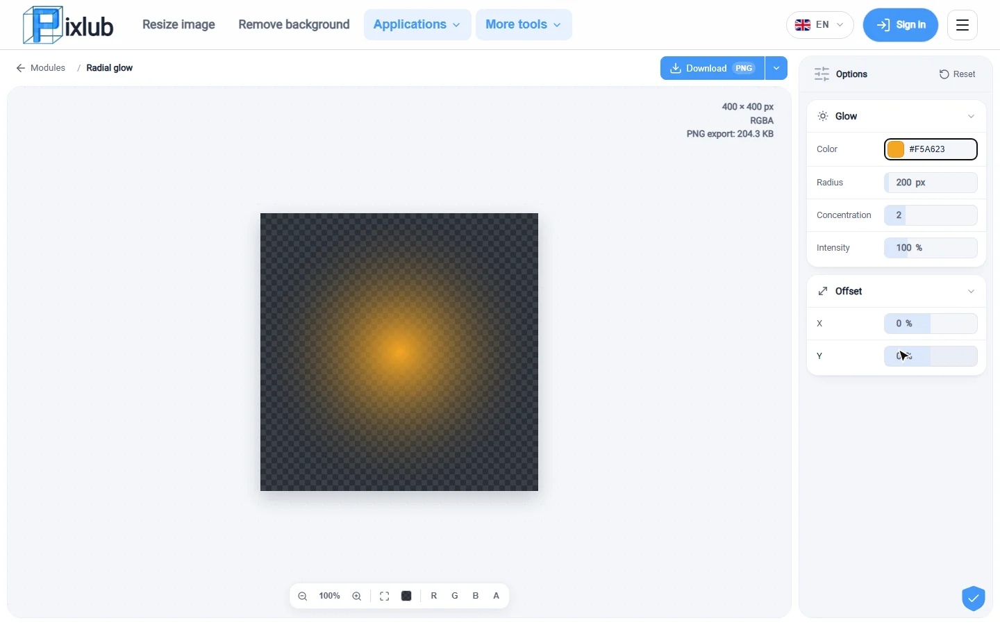

# Resplandor radial

Generar un resplandor redondo que se desvanece hacia los bordes.

**Categoría** : Generación · **Identificador** : `glow`

## Dónde usarlo

- **[Página del módulo](https://pixlub.com/es/module/glow)** : Suelte sus archivos, ajuste y descargue: el módulo por sí solo, sin nada más.
- **[Grafo de imagen](https://pixlub.com/es/image/graph)** : Conéctelo a otros módulos para componer un efecto más complejo.

## Entradas

Este módulo no tiene entrada: crea la imagen solo a partir de sus ajustes.

## Presentación en video

▶ [Ver el video](../../../../assets/modules/glow/demo.en.mp4) : Color, radio y concentración, desplazamiento.

1. `0:00` The render shows right away
2. `0:01` Colour
3. `0:07` Radius and concentration
4. `0:12` Offset the glow
5. `0:15` Export the result

## Uso

1. **Elegir el color**

   El resplandor se muestra sobre fondo transparente.

2. **Ajustar**

   **Radio**, **concentración** (más alta: núcleo más ceñido) e **intensidad**.

## Ajustes

| Ajuste | Efecto |
| --- | --- |
| **Color** | Tono del resplandor. |
| **Radio** | 1 a 4000 px. |
| **Concentración** | 0,2 a 8. |
| **Intensidad** | 0 a 400 %. |
| **Desplazamiento X** / **Y** | Posición del resplandor. |

## Consejos

- Un resplandor cálido desplazado a una esquina imita un rayo de sol que entra en la imagen.

## Exportación

El botón **Descargar** guarda el resultado en el formato del archivo importado: una foto JPEG sale en JPEG. El menú a su derecha abre los **Ajustes de exportación** para elegir otro formato y ajustar la calidad, el tamaño o el fondo, y ofrece **Copiar la imagen**.

- **[La ventana de exportación](../../../../01-app/es/02-image/04-exportation.md)** : Todos los formatos, sus ajustes, el procesamiento local o en el servidor, los lotes y la carpeta local.
