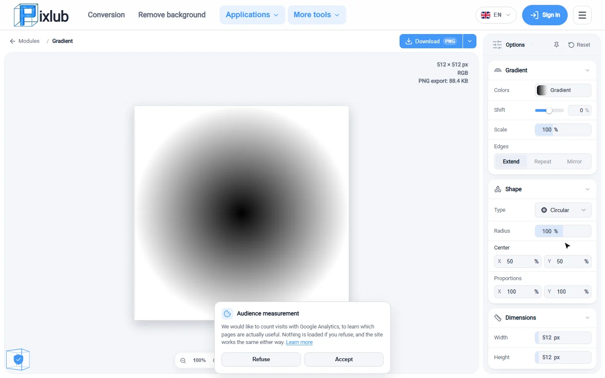

# Degradado

Generar un degradado lineal, circular, radial o en rombo.

**Categoría** : Generación · **Identificador** : `gradient`

## Dónde usarlo

- **[Página del módulo](https://pixlub.com/es/module/gradient)** : Suelte sus archivos, ajuste y descargue: el módulo por sí solo, sin nada más.
- **[Grafo de imagen](https://pixlub.com/es/image/graph)** : Conéctelo a otros módulos para componer un efecto más complejo.

## Entradas

Este módulo no tiene entrada: crea la imagen solo a partir de sus ajustes.

## Presentación en video

▶ [Ver el video](../../../../assets/modules/gradient/demo.en.mp4) : Forma, colores, escala y bordes.

1. `0:00` The render shows right away
2. `0:01` Pick the shape
3. `0:09` Scale and edges
4. `0:15` Shift the colours
5. `0:19` Export the result

## Uso

1. **Elegir la forma**

   Lineal, circular, radial o en rombo.

2. **Elegir los colores**

   Coloque las paradas del degradado, del 0 % (inicio o centro) al 100 % (final o borde).

3. **Colocar**

   Ángulo, centro, radio o proporciones según la forma; escala y desplazamiento para comprimir o deslizar los colores.

## Ajustes

| Ajuste | Efecto |
| --- | --- |
| **Colores** | Las paradas del degradado. |
| **Desplazamiento** | Desliza los colores, −100 a 100 %. |
| **Escala** | Longitud del degradado, 1 a 1000 %. |
| **Bordes** | Más allá de los extremos: **Ampliar**, **Repetir** o **Espejo**. |
| **Tipo** | **Lineal**, **Circular**, **Radial** (una vuelta alrededor del centro) o **Rombo**. |
| **Ángulo** | Lineal, radial y rombo; 0° va de izquierda a derecha. |
| **Radio** | Circular; el 100 % toca los bordes. |
| **Centro** | Posición del centro, en % de la imagen. |
| **Proporciones** | Circular y rombo: estiramiento en X y en Y. |
| **Dimensiones** | Tamaño de la imagen. |

## Consejos

- Escala baja y bordes en **Espejo**: ondas regulares, que un desplazamiento animado hace desfilar sin saltos.
- Como **Mapa** del [Remapeo de textura](../../03-transform/remap/README.md), un degradado radial negro → rojo estira un ruido en rayos.

## Exportación

El botón **Descargar** guarda el resultado en el formato del archivo importado: una foto JPEG sale en JPEG. El menú a su derecha abre los **Ajustes de exportación** para elegir otro formato y ajustar la calidad, el tamaño o el fondo, y ofrece **Copiar la imagen**.

- **[La ventana de exportación](../../../../01-app/es/02-image/04-exportation.md)** : Todos los formatos, sus ajustes, el procesamiento local o en el servidor, los lotes y la carpeta local.
