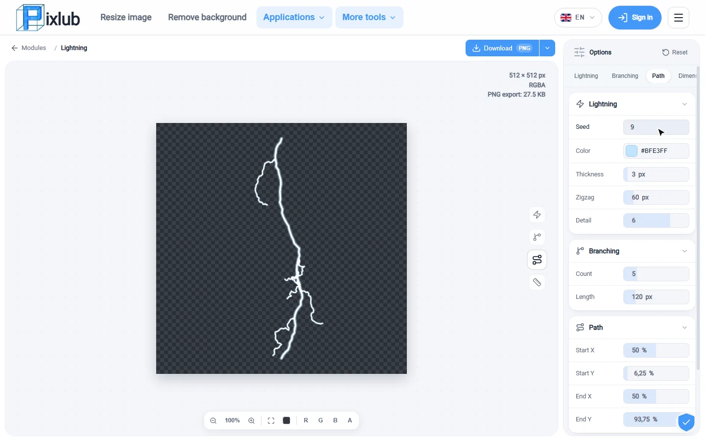

# Rayo

Generar un rayo ramificado entre dos puntos.

**Categoría** : Generación · **Identificador** : `lightning`

## Dónde usarlo

- **[Página del módulo](https://pixlub.com/es/module/lightning)** : Suelte sus archivos, ajuste y descargue: el módulo por sí solo, sin nada más.
- **[Grafo de imagen](https://pixlub.com/es/image/graph)** : Conéctelo a otros módulos para componer un efecto más complejo.

## Entradas

Este módulo no tiene entrada: crea la imagen solo a partir de sus ajustes.

## Presentación en video

▶ [Ver el video](../../../../assets/modules/lightning/demo.en.mp4) : Semilla, zigzag y ramificaciones, trayecto.

1. `0:00` The render shows right away
2. `0:01` Change the seed
3. `0:05` Zigzag and branches
4. `0:11` Bolt path
5. `0:14` Export the result

## Uso

1. **Cambiar la semilla**

   Cada semilla da un rayo distinto.

2. **Ajustar la forma**

   **Zigzag**, **detalle**, número y longitud de las **ramificaciones**.

3. **Colocar el trayecto**

   Puntos de inicio y de llegada, en %.

## Ajustes

| Ajuste | Efecto |
| --- | --- |
| **Semilla** | Sorteo del rayo. |
| **Color** / **Grosor** | Aspecto del trazo. |
| **Zigzag** / **Detalle** | Amplitud y finura de los quiebres. |
| **Ramificaciones** | Número (0 a 24) y longitud. |
| **Trayecto** | Inicio y final X / Y. |
| **Dimensiones** | Tamaño de la zona. |

## Consejos

- Añada [Bloom](../../05-filter/bloom/README.md) sobre el rayo para un halo eléctrico.

## Exportación

El botón **Descargar** guarda el resultado en el formato del archivo importado: una foto JPEG sale en JPEG. El menú a su derecha abre los **Ajustes de exportación** para elegir otro formato y ajustar la calidad, el tamaño o el fondo, y ofrece **Copiar la imagen**.

- **[La ventana de exportación](../../../../01-app/es/02-image/04-exportation.md)** : Todos los formatos, sus ajustes, el procesamiento local o en el servidor, los lotes y la carpeta local.
