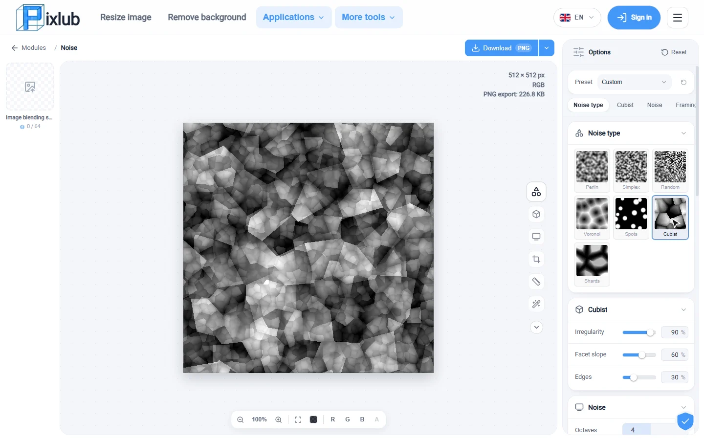

# Ruido

Generar una textura de ruido: Perlin, Voronoi, puntos, cubista, esquirlas…

**Categoría** : Generación · **Identificador** : `noise` · [Referencia de la API](./api.md)

## Dónde usarlo

- **[Página del módulo](https://pixlub.com/es/module/noise)** : Suelte sus archivos, ajuste y descargue: el módulo por sí solo, sin nada más.
- **[Grafo de imagen](https://pixlub.com/es/image/graph)** : Conéctelo a otros módulos para componer un efecto más complejo.

## Entradas

Los archivos que acepta la página del módulo: suéltelos en la zona de importación o haga clic en ella para buscarlos. Un archivo de otro formato se descarta, con un mensaje que recuerda los formatos permitidos.

| Entrada | Formatos aceptados | Archivos |
| --- | --- | --- |
| **Imagen que se va a fusionar** (opcional) Imagen opcional fusionada con el ruido; si está conectada, también define su tamaño. | `PNG`, `JPEG`, `WebP`, `GIF`, `AVIF`, `BMP` | Uno o varios: cada imagen se procesa por separado, con los mismos ajustes |

El número de imágenes que se procesan a la vez depende de su plan.

Mediante la API, los archivos y sus formatos se detallan en la [vista API](./api.md).

## Presentación en video

▶ [Ver el video](../../../../assets/modules/noise/demo.en.mp4) : Tipo de ruido, escala, semilla y luego fusión con una imagen.

1. `0:00` The render shows right away
2. `0:01` Pick the noise type
3. `0:05` Scale and intensity
4. `0:13` Change the seed
5. `0:16` Blend with an image
6. `0:19` Export the result

## Uso

1. **Abrir**

   El ruido se muestra enseguida, sin importar nada.

2. **Elegir el tipo**

   Haga clic en una miniatura: **Perlin**, **Simplex**, **Aleatorio**, **Voronoi**, **Puntos**, **Cubista** o **Esquirlas**.

3. **Ajustar**

   **Escala**, **intensidad** y **semilla**; las pestañas llevan al encuadre y al posprocesamiento.

## Ajustes

| Ajuste | Efecto |
| --- | --- |
| **Tipo** | Cada uno tiene su sección de ajustes (crestas, celdas, puntos…). |
| **Octavas** / **Rampa de octavas** | Capas de detalle superpuestas y su peso. |
| **Intensidad** | Contraste alrededor del gris medio, 0 a 400 %. |
| **Semilla** | Cambia el sorteo; una misma semilla vuelve a dar el mismo ruido. Entre dos enteros, el ruido se desliza de un sorteo a otro: animada, la semilla hace moverse las celdas en lugar de hacerlas saltar. |
| **Encuadre** | Posición, rotación, escala y solapamiento para una textura sin costuras. |
| **Dimensiones** | Ancho y alto; una imagen fusionada impone las suyas. |
| **Posprocesamiento** | Niveles automáticos, curva de reasignación, cuantización en colores planos. |
| **Fusión** | Modo de fusión y opacidad: cómo se aplica el ajuste sobre la imagen original. |

## Consejos

- El **solapamiento** (mosaico) crea una textura que se repite sin costuras.
- Suelte una imagen en **Imagen que se va a fusionar** para aplicar el ruido encima (grano, suciedad).

## Exportación

El botón **Descargar** guarda el resultado en el formato del archivo importado: una foto JPEG sale en JPEG. El menú a su derecha abre los **Ajustes de exportación** para elegir otro formato y ajustar la calidad, el tamaño o el fondo, y ofrece **Copiar la imagen**.

Con varias imágenes, el botón pasa a ser **Descargar en ZIP**; el menú también ofrece los archivos por separado o solo la imagen mostrada.

- **[La ventana de exportación](../../../../01-app/es/02-image/04-exportation.md)** : Todos los formatos, sus ajustes, el procesamiento local o en el servidor, los lotes y la carpeta local.
