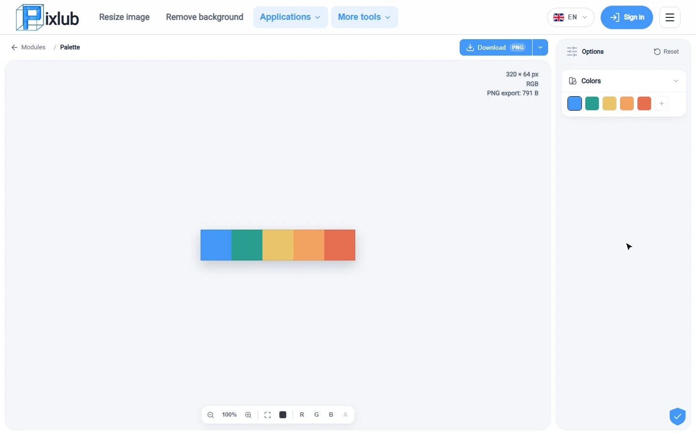

# Paleta

Definir una paleta de colores, para exportarla o reutilizarla en el grafo.

**Categoría** : Generación · **Identificador** : `palette`

## Dónde usarlo

- **[Página del módulo](https://pixlub.com/es/module/palette)** : Suelte sus archivos, ajuste y descargue: el módulo por sí solo, sin nada más.
- **[Grafo de imagen](https://pixlub.com/es/image/graph)** : Conéctelo a otros módulos para componer un efecto más complejo.

## Entradas

Este módulo no tiene entrada: crea la imagen solo a partir de sus ajustes.

## Presentación en video

▶ [Ver el video](../../../../assets/modules/palette/demo.en.mp4) : Modificar un color, añadir otro.

1. `0:00` The render shows right away
2. `0:01` Change a colour
3. `0:06` Add a colour
4. `0:09` Export the result

## Uso

1. **Modificar un color**

   Haga clic en una muestra y luego elija el color (HEX, muestrario o cuentagotas).

2. **Añadir o quitar**

   **+** añade un color; hasta 32.

## Ajustes

| Ajuste | Efecto |
| --- | --- |
| **Colores** | 1 a 32 colores, mostrados en franjas. |

## Consejos

- En el [grafo de imagen](../../../../01-app/es/02-image/01-image-graph.md), una paleta alimenta a los módulos que recolorean.

## Exportación

El botón **Descargar** guarda el resultado en el formato del archivo importado: una foto JPEG sale en JPEG. El menú a su derecha abre los **Ajustes de exportación** para elegir otro formato y ajustar la calidad, el tamaño o el fondo, y ofrece **Copiar la imagen**.

- **[La ventana de exportación](../../../../01-app/es/02-image/04-exportation.md)** : Todos los formatos, sus ajustes, el procesamiento local o en el servidor, los lotes y la carpeta local.
