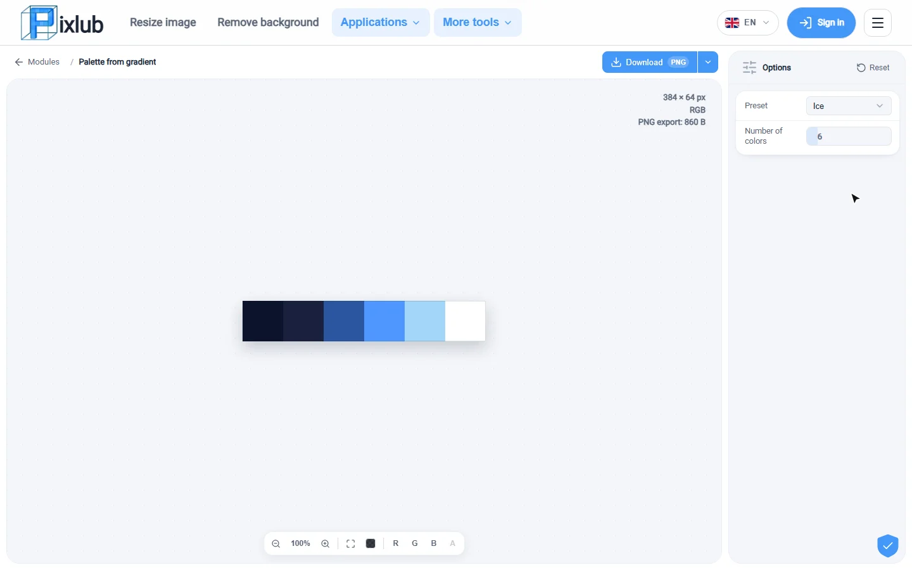

# Paleta a partir de un degradado

Dividir un degradado en un número fijo de colores.

**Categoría** : Generación · **Identificador** : `paletteFromGradient`

## Dónde usarlo

- **[Página del módulo](https://pixlub.com/es/module/paletteFromGradient)** : Suelte sus archivos, ajuste y descargue: el módulo por sí solo, sin nada más.
- **[Grafo de imagen](https://pixlub.com/es/image/graph)** : Conéctelo a otros módulos para componer un efecto más complejo.

## Entradas

Este módulo no tiene entrada: crea la imagen solo a partir de sus ajustes.

## Presentación en video

▶ [Ver el video](../../../../assets/modules/paletteFromGradient/demo.en.mp4) : Degradados predefinidos y luego número de colores.

1. `0:00` The render shows right away
2. `0:01` Start from a ready-made gradient
3. `0:08` Number of colours
4. `0:12` Export the result

## Uso

1. **Elegir un degradado**

   Un **preajuste** (anochecer, fuego, hielo…) o **Personalizado** para dibujar el suyo.

2. **Elegir el número**

   El degradado se muestrea a intervalos regulares.

## Ajustes

| Ajuste | Efecto |
| --- | --- |
| **Preajuste** | Personalizado, Anochecer, Fuego, Hielo, Bosque, Pastel, Escala de grises. |
| **Número de colores** | 2 a 32. |
| **Degradado** | En Personalizado: los puntos del degradado. |

## Consejos

- Práctico para una gama de colores regular (gráficos, mapas de calor).

## Exportación

El botón **Descargar** guarda el resultado en el formato del archivo importado: una foto JPEG sale en JPEG. El menú a su derecha abre los **Ajustes de exportación** para elegir otro formato y ajustar la calidad, el tamaño o el fondo, y ofrece **Copiar la imagen**.

- **[La ventana de exportación](../../../../01-app/es/02-image/04-exportation.md)** : Todos los formatos, sus ajustes, el procesamiento local o en el servidor, los lotes y la carpeta local.
