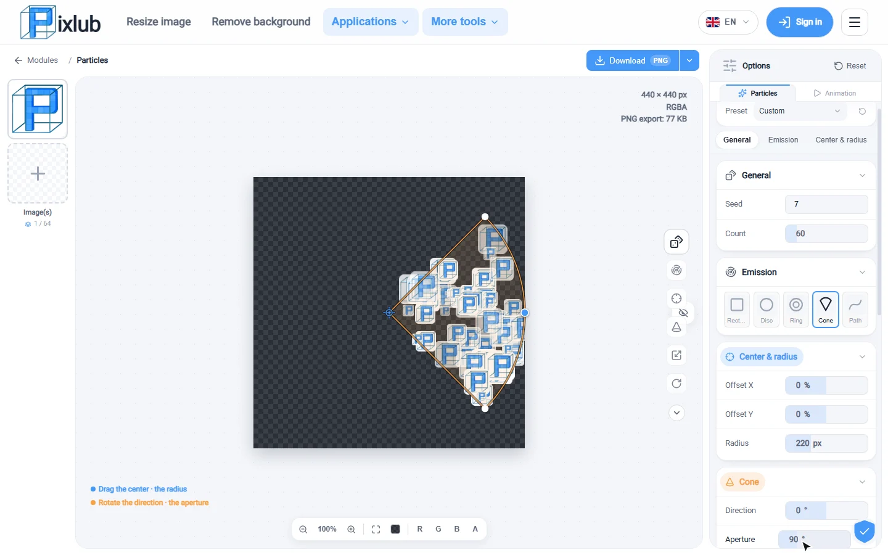
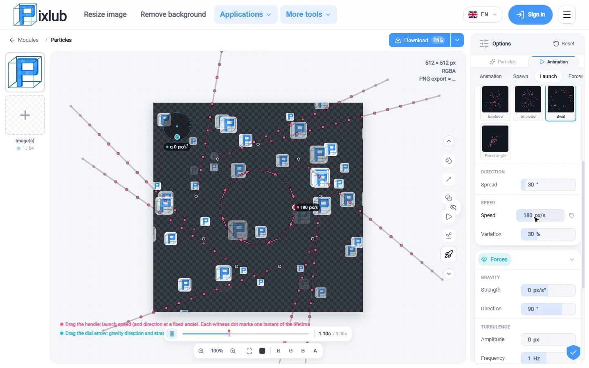

# Partículas

Dispersar una imagen en partículas, fijas o animadas: forma de emisión, tamaño, estelas, movimiento.

**Categoría** : Generación · **Identificador** : `particles` · [Referencia de la API](./api.md)

## Dónde usarlo

- **[Página del módulo](https://pixlub.com/es/module/particles)** : Suelte sus archivos, ajuste y descargue: el módulo por sí solo, sin nada más.
- **[Grafo de imagen](https://pixlub.com/es/image/graph)** : Conéctelo a otros módulos para componer un efecto más complejo.

## Entradas

Los archivos que acepta la página del módulo: suéltelos en la zona de importación o haga clic en ella para buscarlos. Un archivo de otro formato se descarta, con un mensaje que recuerda los formatos permitidos.

| Entrada | Formatos aceptados | Archivos |
| --- | --- | --- |
| **Imagen(es)** (obligatoria) Imagen dispersada en partículas; un lote reparte sus imágenes entre las partículas. | `PNG`, `JPEG`, `WebP`, `GIF`, `AVIF`, `BMP` | Hasta 64 archivos, reunidos en un lote |

Mediante la API, los archivos y sus formatos se detallan en la [vista API](./api.md).

## Presentación en video

▶ [Ver el video](../../../../assets/modules/particles/demo.en.mp4) : Partículas fijas: número, forma de emisión, tamaño, rotación, estela, preajuste.

1. `0:00` Import the image to scatter
2. `0:02` Count and seed
3. `0:07` Emission shape: cone
4. `0:11` Random size and rotation
5. `0:19` Trail along the motion
6. `0:24` Or a still preset
7. `0:31` Export the result

## Uso

1. **Importar**

   Suelte la imagen que dispersar. Un lote reparte sus imágenes entre las partículas.

2. **Dispersar**

   **Número** y **semilla**, y luego la **forma de emisión**: rectángulo, disco, anillo, cono o trazado.

3. **Variar**

   Tamaños, rotaciones y opacidades mín. / máx.: cada partícula toma su valor al azar entre ambos.

Sin animación, el módulo genera una imagen fija. Un **preajuste** (nieve, bokeh, confeti…) lo ajusta todo de una vez; el filtro **Animados / Fijos** los clasifica.

## Ajustes (pestaña Partículas)

| Ajuste | Efecto |
| --- | --- |
| **Semilla** / **Número** | Sorteo y cantidad (1 a 3000). Otra semilla lo redistribuye todo. |
| **Forma de emisión** | Rectángulo, disco, anillo, cono o trazado, con centro, radio, apertura… |
| **Tamaño**, **Rotación**, **Opacidad** | Límites mín. y máx. sorteados al azar. |
| **Dirección y estela** | Orientar según la dirección, longitud y atenuación de la estela. |
| **Renderizado** | Modo de fusión de una partícula sobre las demás. |

## Animar las partículas

▶ [Ver el video](../../../../assets/modules/particles/motion.en.mp4) : Animación: nacimiento, impulso, fuerzas, final de la vida, reproducción, preajuste animado, exportación en GIF.

1. `0:00` Import the image to scatter
2. `0:05` Turn the animation on
3. `0:10` Spawn: looping, lifetime
4. `0:14` Launch: swirl and speed
5. `0:22` Forces: gravity
6. `0:26` Over lifetime: fade and size
7. `0:34` Play, pause, scrub
8. `0:42` Or an animated preset
9. `0:52` Export as an animated GIF

1. **Activar la animación**

   En la pestaña **Animación**, marque **Animar las partículas**: la vista previa empieza a reproducirse en bucle.

2. **Ajustar el nacimiento**

   **Bucle** (flujo continuo), **Una vez** (una ráfaga tras un retraso) o **Fija** (un solo instante). La **duración de vida** fija el tiempo de una partícula.

3. **Lanzar y empujar**

   **Impulso**: explosión, implosión, remolino o ángulo fijo, con velocidad y dispersión. **Fuerzas**: gravedad, turbulencia, rozamiento.

4. **Hacer vivir y morir**

   **A lo largo de la vida**: aparición, extinción, tamaño al final de la vida, rotación.

5. **Exportar**

   Bajo la vista previa, la minilínea de tiempo reproduce, detiene y recorre la animación. En **Ajustes de exportación**, pestaña **Animado**: **GIF animado** o **APNG**.

| Ajuste | Efecto |
| --- | --- |
| **Nacimiento** | Bucle, una vez (con **retraso**) o fija (con **fase**). |
| **Duración de vida** | 0 a 20 s por partícula. El bucle dura un número entero de vidas: se une sin saltos. |
| **Impulso** | Dirección (explosión, implosión, remolino, ángulo fijo), dispersión, velocidad y su variación. |
| **Fuerzas** | Gravedad (fuerza y dirección), turbulencia (amplitud, frecuencia), rozamiento. |
| **A lo largo de la vida** | Aparición y extinción (parte de la vida), tamaño final, velocidad de rotación. |
| **Controlar por fase** | La animación deja de seguir el tiempo por sí sola: su **fase** (0 a 100 %) se fija con fotogramas clave. |

En la vista previa, el controlador rosa ajusta la velocidad del impulso, y el dial de arriba a la izquierda, la dirección y la fuerza de la gravedad; los puntos testigo marcan la trayectoria a intervalos regulares.

### En el grafo de imagen

Un módulo Partículas animado se reproduce solo en el [grafo de imagen](../../../../01-app/es/02-image/01-image-graph.md#animacion): se abre la franja de tiempo y el bucle toma la duración de la animación. Para sincronizarlo con otros elementos, marque **Controlar por fase** y coloque fotogramas clave en **Fase** en la línea de tiempo (0 %: inicio, 100 %: final). La exportación se hace con el módulo **Exportación**, en APNG por defecto.

## Consejos

- Para un bucle sin tirones, mantenga la duración de la animación como múltiplo de la **duración de vida**.
- **Fija** + **Fase** da una imagen fija de un instante preciso de la animación (una explosión a medio recorrido, por ejemplo).
- Un GIF solo conserva 256 colores: para partículas suaves o transparentes, prefiera el APNG.

## Exportación

El botón **Descargar** guarda el resultado en el formato del archivo importado: una foto JPEG sale en JPEG. El menú a su derecha abre los **Ajustes de exportación** para elegir otro formato y ajustar la calidad, el tamaño o el fondo, y ofrece **Copiar la imagen**.

Con varias imágenes, el botón pasa a ser **Descargar en ZIP**; el menú también ofrece los archivos por separado o solo la imagen mostrada.

- **[La ventana de exportación](../../../../01-app/es/02-image/04-exportation.md)** : Todos los formatos, sus ajustes, el procesamiento local o en el servidor, los lotes y la carpeta local.
