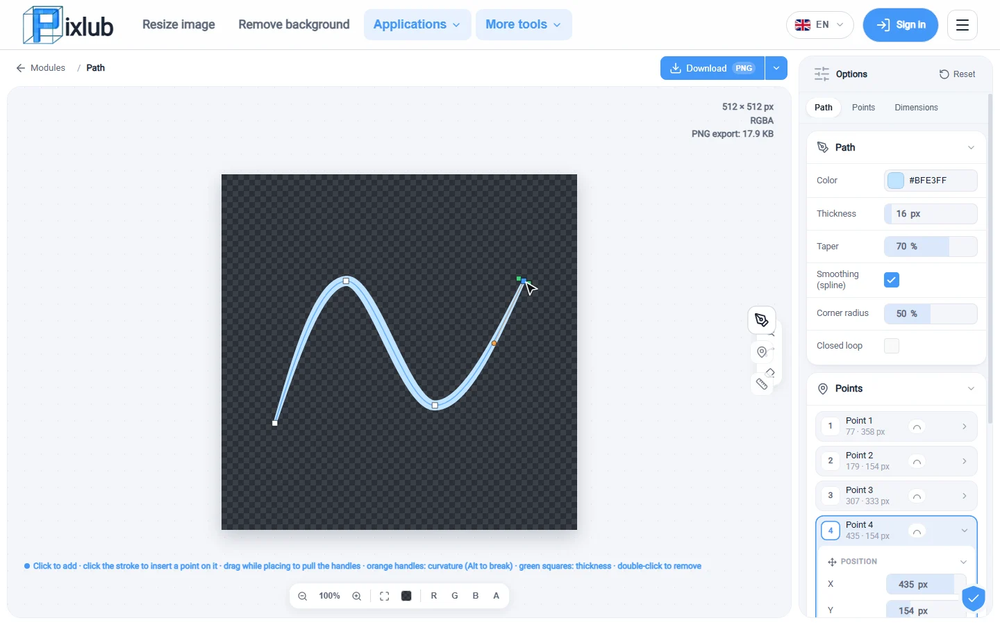

# Trazado

Dibujar trazados vectoriales: pluma, lápiz, formas, trazos afilados y rellenos.

**Categoría** : Generación · **Identificador** : `pathStroke`

## Dónde usarlo

- **[Página del módulo](https://pixlub.com/es/module/pathStroke)** : Suelte sus archivos, ajuste y descargue: el módulo por sí solo, sin nada más.
- **[Grafo de imagen](https://pixlub.com/es/image/graph)** : Conéctelo a otros módulos para componer un efecto más complejo.

## Entradas

Este módulo no tiene entrada: crea la imagen solo a partir de sus ajustes.

## Presentación en video

▶ [Ver el video](../../../../assets/modules/pathStroke/demo.en.mp4) : Dibujar el trazado, grosor y afilado, color.

1. `0:00` The render shows right away
2. `0:01` Draw the path
3. `0:07` Thickness and taper
4. `0:13` Colour
5. `0:18` Export the result

## Uso

1. **Elegir un modo**

   La barra en la parte superior de la vista previa ofrece dos modos. **Básico** da las herramientas vectoriales habituales. **Redondeado** coloca puntos unidos por arcos, para los bucles y los círculos.

2. **Dibujar**

   En modo Básico, tome la **pluma** (un clic coloca un punto de esquina y un arrastre tira una curva), el **lápiz** (un trazo a mano alzada se convierte en un trazado suavizado) o una **forma**: segmento, rectángulo, elipse, polígono, estrella. Cada dibujo añade un trazado a la lista.

3. **Retocar**

   La **selección** mueve, redimensiona y gira trazados enteros. La **selección directa** mueve los puntos, sus controladores de curvatura y su grosor local. Las **tijeras** cortan un trazado.

4. **Ajustar el aspecto**

   Las **capas**, abajo a la izquierda de la vista previa, ordenan los trazados y se despliegan para mostrar sus puntos. El panel de la derecha muestra la ficha del trazado elegido: trazo, relleno, afilado, guiones, opacidad.

## Herramientas del modo Básico

| Herramienta | Tecla | Gestos |
| --- | --- | --- |
| **Selección** | V | Hacer clic en un trazado (**Mayús**: varios), arrastrarlo (**Alt**: copiar), tirar de los controladores del cuadro, girar a su alrededor. Doble clic: editar sus puntos. |
| **Selección directa** | A | Arrastrar un punto o sus controladores naranjas (**Alt**: romper, **Ctrl**: simétricos). **Alt** + arrastrar un punto: sacar controladores nuevos. Cuadrados verdes: grosor local. Doble clic: punto de esquina o redondeado. |
| **Pluma** | P | Clic: punto de esquina. Arrastrar: curva. Clic en el primer punto: cerrar. Clic en un extremo: prolongar. Clic en el trazo elegido: insertar un punto. Clic en un punto: quitarlo (**Alt**: esquina o redondeado). **Intro** o doble clic: terminar. |
| **Lápiz** | N | Dibujar a mano alzada. Empezar desde el extremo de un trazado elegido lo prolonga; volver al punto de partida lo cierra. |
| **Segmento**, **Rectángulo**, **Elipse** | L, M, E | Arrastrar. **Mayús**: ángulo en pasos de 15°, cuadrado o círculo. **Alt**: desde el centro. |
| **Polígono**, **Estrella** | Y, S | Arrastrar desde el centro: tamaño y orientación. |
| **Tijeras** | C | Hacer clic en un trazado o en un punto: cortarlo en ese lugar. |

**Supr** quita los puntos o los trazados elegidos, las flechas los desplazan un píxel (**Mayús**: diez), **Ctrl+D** duplica, **Ctrl+J** une dos trazados o cierra un trazado solo.

A la izquierda de la vista previa, las acciones alinean y reparten los trazados elegidos, cambian su orden, los invierten, los simplifican o los convierten en un **recorte**: el trazado borra entonces lo que está pintado debajo en lugar de sumarse.

Con varios trazados elegidos, **Combinar las formas** los reúne en uno solo: **Unir**, **Restar la forma superior**, **Intersecar**, **Excluir la superposición**. El resultado toma el aspecto del trazado del fondo; un agujero se convierte en un trazado de recorte.

## Capas

El panel **Capas** enumera los trazados, con el superior primero. Arrastre una línea para cambiar el orden, haga clic en el ojo para ocultar y en el candado para bloquear, y haga doble clic en el nombre para cambiarlo. La flecha despliega un trazado para mostrar sus puntos: un clic en un punto lo elige y activa la selección directa. En el editor de imágenes, estas mismas líneas se despliegan bajo la capa de trazados; en la ventana «Dibujar el trazado», salen de un cajón.

## Modo Redondeado

Haga clic para colocar puntos: cada uno se redondea en un arco con sus vecinos. Los puntos se ajustan magnéticamente a los demás puntos y al centro, y **Mayús** los guía en pasos de 15°. **Alt** + clic en un punto lo vuelve de esquina, o de nuevo redondeado. **Círculo perfecto** recoloca los puntos sobre un círculo y **Repartir los puntos** regulariza una forma ya dibujada. El modo trabaja sobre el trazado elegido en la lista; **Nuevo trazado** empieza otro.

## Ajustes

| Ajuste | Efecto |
| --- | --- |
| **Trazados** | La ficha del trazado elegido en las capas. |
| **Trazo** | Color, grosor, afilado de los extremos, forma de los extremos y de las esquinas, guiones. |
| **Relleno** | Color del interior del trazado y opacidad del trazado entero. |
| **Forma** | Nombre, cierre, redondeo de los puntos redondeados (50 % = arcos de círculo exactos), recorte, bloqueo, tramo mostrado. |
| **Punto** | Posición, grosor local y tipo del punto elegido; en el grafo, X, Y y el grosor de cada punto se pueden animar. |
| **Tramo** | Inicio y final del trazo visible de todos los trazados, en % de su longitud: animado de 0 a 100 %, el dibujo se va trazando. |
| **Dimensiones** | Tamaño de la zona. |

## Consejos

- La salida **Camino** devuelve el primer trazado visible de la pila: es el que siguen los módulos Seguir un camino, Curvar sobre un camino y Partículas.
- Un trazado dibujado antes de la llegada de las herramientas vectoriales se abre tal cual, como un documento de un solo trazado.

## Exportación

El botón **Descargar** guarda el resultado en el formato del archivo importado: una foto JPEG sale en JPEG. El menú a su derecha abre los **Ajustes de exportación** para elegir otro formato y ajustar la calidad, el tamaño o el fondo, y ofrece **Copiar la imagen**.

- **[La ventana de exportación](../../../../01-app/es/02-image/04-exportation.md)** : Todos los formatos, sus ajustes, el procesamiento local o en el servidor, los lotes y la carpeta local.
