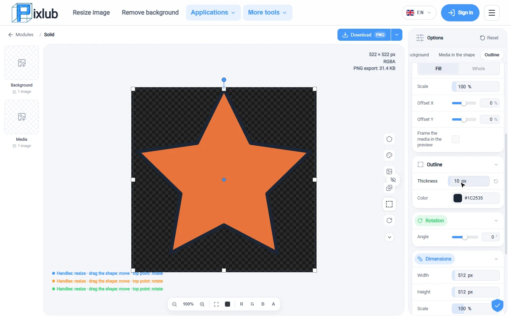

# Sólido

Generar una forma rellena: color, degradado o imagen en su interior.

**Categoría** : Generación · **Identificador** : `solid` · [Referencia de la API](./api.md)

## Dónde usarlo

- **[Página del módulo](https://pixlub.com/es/module/solid)** : Suelte sus archivos, ajuste y descargue: el módulo por sí solo, sin nada más.
- **[Grafo de imagen](https://pixlub.com/es/image/graph)** : Conéctelo a otros módulos para componer un efecto más complejo.

## Entradas

Los archivos que acepta la página del módulo: suéltelos en la zona de importación o haga clic en ella para buscarlos. Un archivo de otro formato se descarta, con un mensaje que recuerda los formatos permitidos.

| Entrada | Formatos aceptados | Archivos |
| --- | --- | --- |
| **Fondo** (opcional) Imagen opcional colocada bajo la forma; si está conectada, también define el tamaño del resultado. | `PNG`, `JPEG`, `WebP`, `GIF`, `AVIF`, `BMP` | Un archivo |
| **Medio** (opcional) Imagen opcional vista a través de la forma, en lugar de su color; el contorno queda por encima. | `PNG`, `JPEG`, `WebP`, `GIF`, `AVIF`, `BMP` | Un archivo |

Mediante la API, los archivos y sus formatos se detallan en la [vista API](./api.md).

## Presentación en video

▶ [Ver el video](../../../../assets/modules/solid/demo.en.mp4) : Forma, color, contorno, desplazamiento y luego una imagen dentro de la forma.

1. `0:00` The render shows right away
2. `0:01` Pick the shape
3. `0:05` Colour
4. `0:10` Add an outline
5. `0:13` Move and rotate with the mouse
6. `0:17` An image inside the shape
7. `0:20` Export the result

## Uso

1. **Elegir la forma**

   Rectángulo, círculo, elipse, anillo, triángulo, rombo, polígono o estrella.

2. **Colorear**

   Color sólido o degradado, con contorno opcional.

3. **Colocar**

   En la vista previa: arrastre para mover, tire de los controladores y del punto superior para girar.

## Ajustes

| Ajuste | Efecto |
| --- | --- |
| **Forma** | Con sus propios ajustes: redondeo, grosor del anillo, lados, puntas. |
| **Color** / **Relleno interior** | Color o degradado; fundido desde el centro. |
| **Fondo** | Imagen opcional bajo la forma; fija el tamaño del resultado. |
| **Medio dentro de la forma** | Imagen vista a través de la forma: rellenar o entera, escala, desplazamiento. |
| **Contorno** | Grosor y color. |
| **Dimensiones**, **Posición**, **Rotación** | Tamaño de la zona y lugar de la forma. |

## Consejos

- Una foto dentro de un círculo da un avatar en un solo gesto.
- Un doble clic en la forma pasa al encuadre del medio en la vista previa.

## Exportación

El botón **Descargar** guarda el resultado en el formato del archivo importado: una foto JPEG sale en JPEG. El menú a su derecha abre los **Ajustes de exportación** para elegir otro formato y ajustar la calidad, el tamaño o el fondo, y ofrece **Copiar la imagen**.

- **[La ventana de exportación](../../../../01-app/es/02-image/04-exportation.md)** : Todos los formatos, sus ajustes, el procesamiento local o en el servidor, los lotes y la carpeta local.
