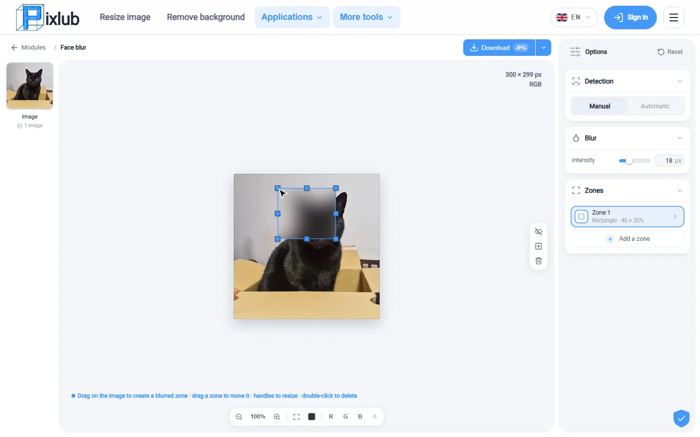

# Difuminado de rostros

Desenfocar zonas trazadas a mano, o los rostros detectados por IA.

**Categoría** : Servicios de API · **Identificador** : `faceBlurApi` · [Referencia de la API](./api.md)

## Dónde usarlo

- **[Página del módulo](https://pixlub.com/es/module/faceBlurApi)** : Suelte sus archivos, ajuste y descargue: el módulo por sí solo, sin nada más.
- **[Grafo de imagen](https://pixlub.com/es/image/graph)** : Conéctelo a otros módulos para componer un efecto más complejo.

## Entradas

Los archivos que acepta la página del módulo: suéltelos en la zona de importación o haga clic en ella para buscarlos. Un archivo de otro formato se descarta, con un mensaje que recuerda los formatos permitidos.

| Entrada | Formatos aceptados | Archivos |
| --- | --- | --- |
| **Imagen** (obligatoria) Imagen cuyas zonas se difuminan. En modo automático, se envía al servidor para detectar los rostros. | `PNG`, `JPEG`, `WebP` | Un archivo |

Mediante la API, los archivos y sus formatos se detallan en la [vista API](./api.md).

## Presentación en video

▶ [Ver el video](../../../../assets/modules/faceBlurApi/demo.en.mp4) : Trazar una zona, moverla, ajustar la intensidad.

1. `0:00` Import a photo
2. `0:03` Draw a zone to blur
3. `0:06` Move the zone
4. `0:09` Blur intensity
5. `0:13` Export the result

## Uso

1. **Importar**

   Suelte una foto.

2. **Modo manual**

   Arrastre sobre la vista previa para trazar una zona; arrástrela para moverla, tire de sus controladores y haga doble clic para eliminarla.

3. **O modo automático**

   Nuestros servidores detectan los rostros (cuenta y créditos); después, las zonas siguen siendo modificables.

## Ajustes

| Ajuste | Efecto |
| --- | --- |
| **Modo** | **Manual** (local, gratuito) o **Automático** (detección por IA). |
| **Intensidad** | 1 a 60 px de desenfoque. |
| **Zonas** | La lista de las zonas desenfocadas. |

## Consejos

- En modo manual, nada sale de su navegador: la insignia se queda en «Procesamiento local».

## Exportación

El botón **Descargar** guarda el resultado en el formato del archivo importado: una foto JPEG sale en JPEG. El menú a su derecha abre los **Ajustes de exportación** para elegir otro formato y ajustar la calidad, el tamaño o el fondo, y ofrece **Copiar la imagen**.

- **[La ventana de exportación](../../../../01-app/es/02-image/04-exportation.md)** : Todos los formatos, sus ajustes, el procesamiento local o en el servidor, los lotes y la carpeta local.
