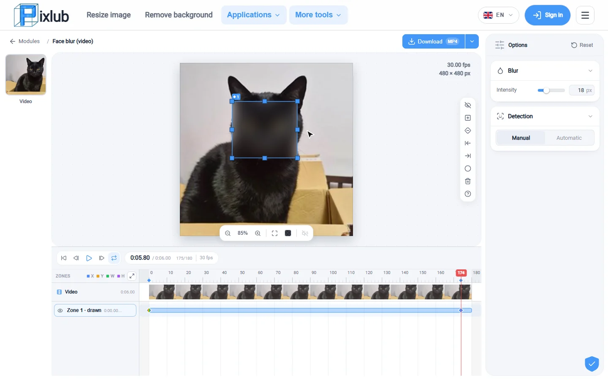

# Difuminado de rostros (video)

Desenfocar zonas trazadas a mano, o los rostros detectados en cada fotograma de un video.

**Categoría** : Servicios de API · **Identificador** : `faceBlurVideoApi`

## Dónde usarlo

- **[Página del módulo](https://pixlub.com/es/module/faceBlurVideoApi)** : Suelte sus archivos, ajuste y descargue: el módulo por sí solo, sin nada más.
- **[Editor de video](https://pixlub.com/es/video/editor)** : Añádalo como efecto en un clip del montaje.

## Entradas

Los archivos que acepta la página del módulo: suéltelos en la zona de importación o haga clic en ella para buscarlos. Un archivo de otro formato se descarta, con un mensaje que recuerda los formatos permitidos.

| Entrada | Formatos aceptados | Archivos |
| --- | --- | --- |
| **Video** (obligatoria) Video difuminado en el navegador. En modo automático, se envía una vez al servidor para detectar los rostros. | `MP4`, `WebM`, `MOV`, `MKV` | Un archivo |

## Presentación en video

▶ [Ver el video](../../../../assets/modules/faceBlurVideoApi/demo.en.mp4) : Trazar una zona sobre el rostro, reajustarla más adelante, reproducir el resultado.

1. `0:00` Import a video
2. `0:03` Draw a zone over the face
3. `0:06` Further on, move it back: a key is set
4. `0:11` The keys in the timeline
5. `0:16` Play: the blur follows the face
6. `0:25` Blur intensity
7. `0:29` Export the result

## Uso

1. **Importar**

   Suelte un video: en modo **Manual**, no sale de su equipo.

2. **Trazar una zona**

   Arrastre sobre la vista previa para cubrir un rostro; la zona vale para todo el video.

3. **Hacer que siga al rostro**

   Más adelante en el video, arrastre la zona sobre el rostro: se coloca un fotograma clave y los fotogramas entre dos claves siguen el movimiento.

4. **O modo automático**

   Nuestros servidores detectan los rostros de cada fotograma (cuenta y créditos); después, las zonas siguen siendo modificables.

## Ajustes

| Ajuste | Efecto |
| --- | --- |
| **Modo** | **Manual** (zonas trazadas, todo se queda en local) o **Automático** (detección por nuestros servidores). |
| **Intensidad** | 1 a 60 px de desenfoque. |
| **Altura de trabajo** | Automático: de 360 a 1080 px; cuanto más baja, más rápida es la detección. |
| **Margen alrededor del rostro** | Automático: ensancha cada zona detectada para seguir los movimientos. |
| **Persistencia** | Automático: 0 a 30 fotogramas durante los que una zona se mantiene cuando ya no se encuentra el rostro. |

## Consejos

- En la línea de tiempo, cada fotograma clave se colorea según lo que fija (X, Y, ancho, alto): pase el mouse por encima para ver sus valores, haga clic para introducirlos, **Supr** lo quita y <kbd>Ctrl</kbd> + <kbd>Z</kbd> lo deshace.
- En modo automático, suba la **persistencia** si un desenfoque parpadea cuando una persona gira la cabeza.

## Exportación

El resultado se exporta desde la página del módulo o desde el editor de video, en MP4, WebM u otro contenedor de video, sin salir de su navegador.

- **[El editor de video](../../../../01-app/es/03-video/01-video-editor.md)** : Editar, ajustar los efectos y exportar un video.
