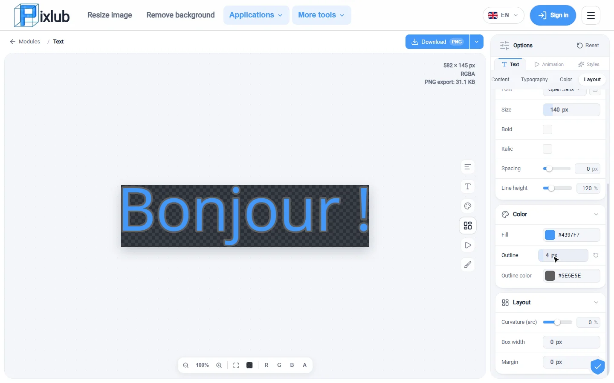

# Texto

Componer un texto: fuente, color o degradado, estilos y animación.

**Categoría** : Texto · **Identificador** : `text`

## Dónde usarlo

- **[Página del módulo](https://pixlub.com/es/module/text)** : Suelte sus archivos, ajuste y descargue: el módulo por sí solo, sin nada más.
- **[Grafo de imagen](https://pixlub.com/es/image/graph)** : Conéctelo a otros módulos para componer un efecto más complejo.

## Entradas

Este módulo no tiene entrada: crea la imagen solo a partir de sus ajustes.

## Presentación en video

▶ [Ver el video](../../../../assets/modules/text/demo.en.mp4) : Escribir, tamaño, color, contorno, curvatura.

1. `0:00` The text shows right away
2. `0:01` Write the text
3. `0:04` Size, colour and outline
4. `0:15` Curve the text
5. `0:19` Export the result

## Uso

1. **Escribir**

   Escriba el texto en **Contenido**; los saltos de línea se introducen directamente.

2. **Dar formato**

   Fuente, tamaño, negrita, espaciado, color o degradado, contorno, curvatura.

3. **Animar o estilizar**

   La pestaña **Animación** hace aparecer el texto y la pestaña **Estilos** apila efectos sobre el texto.

## Ajustes

| Ajuste | Efecto |
| --- | --- |
| **Contenido** | Texto, alineación y mayúsculas y minúsculas. |
| **Tipografía** | Fuente (o la suya, importada), tamaño, negrita, cursiva, espaciado, interlineado. |
| **Color** | Relleno sólido o degradado, contorno. |
| **Maquetación** | Curvatura en arco, ancho del cuadro (salto de línea), margen. |
| **Animación** | Una entrada animada (fundido, rebote, máquina de escribir…), con duración y retraso. |
| **Estilos** | Una pila de efectos aplicados sobre el texto. |

## Consejos

- Exporte en PNG para un texto recortado, y en GIF o APNG para una animación.
- El **preajuste** en la parte superior del panel da un estilo completo con un clic.

## Exportación

El botón **Descargar** guarda el resultado en el formato del archivo importado: una foto JPEG sale en JPEG. El menú a su derecha abre los **Ajustes de exportación** para elegir otro formato y ajustar la calidad, el tamaño o el fondo, y ofrece **Copiar la imagen**.

- **[La ventana de exportación](../../../../01-app/es/02-image/04-exportation.md)** : Todos los formatos, sus ajustes, el procesamiento local o en el servidor, los lotes y la carpeta local.
