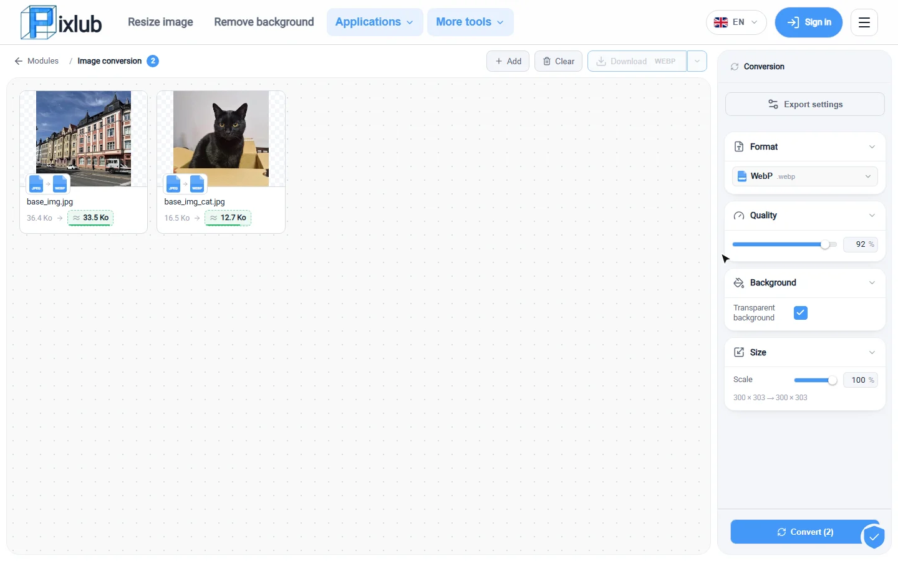

# Conversión

Convertir imágenes, videos y sonidos a cualquier formato de la exportación, con el peso estimado.

**Categoría** : Conversión · **Identificador** : `convert` · [Referencia de la API](./api.md)

## Dónde usarlo

- **[Página del módulo](https://pixlub.com/es/module/convert)** : Suelte sus archivos, ajuste y descargue: el módulo por sí solo, sin nada más.

## Entradas

Los archivos que acepta la página del módulo: suéltelos en la zona de importación o haga clic en ella para buscarlos. Un archivo de otro formato se descarta, con un mensaje que recuerda los formatos permitidos.

| Entrada | Formatos aceptados | Archivos |
| --- | --- | --- |
| **Imagen(es)** (obligatoria) Imagen(es) que se van a convertir al formato elegido. | `PNG`, `JPEG`, `WebP`, `GIF`, `AVIF`, `BMP` | Uno o varios: cada imagen se procesa por separado, con los mismos ajustes |

El número de imágenes que se procesan a la vez depende de su plan.

Mediante la API, los archivos y sus formatos se detallan en la [vista API](./api.md).

## Presentación en video

▶ [Ver el video](../../../../assets/modules/convert/demo.en.mp4) : Importar, elegir el formato y la escala, y luego convertir.

1. `0:00` Import images
2. `0:03` Pick the format
3. `0:07` Scale and estimated size
4. `0:11` Convert

## Uso

1. **Importar**

   Suelte sus imágenes; cada tarjeta muestra el formato original, el nuevo y el peso estimado.

2. **Elegir el formato**

   El menú **Formato** ofrece todo el catálogo de exportación; **Ajustes de exportación** abre sus ajustes.

3. **Convertir**

   **Convertir** procesa el lote.

## Ajustes

| Ajuste | Efecto |
| --- | --- |
| **Formato** | PNG, JPEG, WebP, AVIF… Se señalan los formatos calculados en nuestros servidores. |
| **Fondo transparente** | Se conserva si el formato lo permite; si no, se sustituye por un color. |
| **Escala** | Reduce las imágenes en el momento de la conversión. |

## Consejos

- El peso estimado ayuda a elegir entre calidad y ligereza antes de convertir.
- Para cada formato, consulte la [ventana de exportación](../../../../01-app/es/02-image/04-exportation.md).

## Exportación

El botón **Descargar** guarda el resultado en el formato del archivo importado: una foto JPEG sale en JPEG. El menú a su derecha abre los **Ajustes de exportación** para elegir otro formato y ajustar la calidad, el tamaño o el fondo, y ofrece **Copiar la imagen**.

Este módulo fija por sí mismo el formato del archivo devuelto, según sus ajustes: PNG, JPEG, WebP.

Con varias imágenes, el botón pasa a ser **Descargar en ZIP**; el menú también ofrece los archivos por separado o solo la imagen mostrada.

- **[La ventana de exportación](../../../../01-app/es/02-image/04-exportation.md)** : Todos los formatos, sus ajustes, el procesamiento local o en el servidor, los lotes y la carpeta local.
