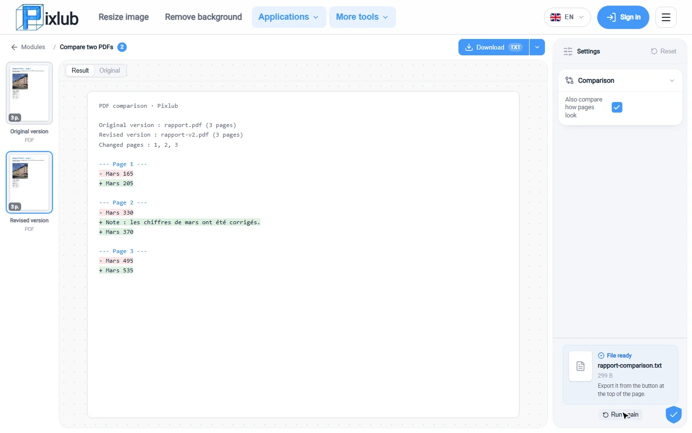

# Comparar dos PDF

Enumerar las líneas añadidas y eliminadas, página por página, entre dos versiones de un PDF.

**Categoría** : Documentos · **Identificador** : `docCompare`

## Dónde usarlo

- **[Página del módulo](https://pixlub.com/es/module/docCompare)** : Suelte sus archivos, ajuste y descargue: el módulo por sí solo, sin nada más.

## Presentación en video

▶ [Ver el video](../../../../assets/modules/docCompare/demo.en.mp4) : Dos versiones, comparación, informe.

1. `0:00` Import both versions
2. `0:07` Compare
3. `0:13` Download the result

## Uso

1. **Importar**

   La **versión inicial** en la primera casilla y la **versión modificada** en la segunda.

2. **Iniciar**

   El informe enumera, página por página, las líneas eliminadas (−) y añadidas (+).

## Ajustes

| Ajuste | Efecto |
| --- | --- |
| **Comparar también el aspecto de las páginas** | Señala las páginas con texto idéntico pero con una maquetación diferente. Más lento. |

## Consejos

- El informe se descarga en texto, para adjuntarlo a una revisión.
