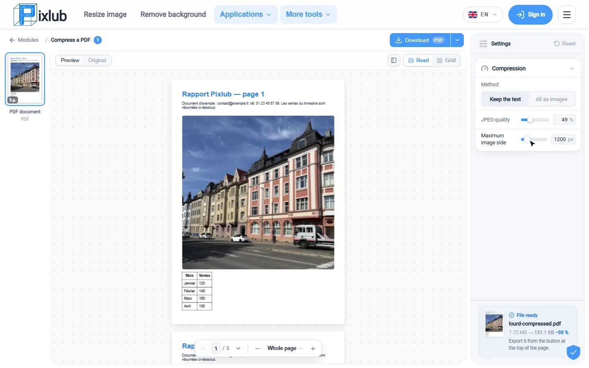

# Comprimir un PDF

Reducir el peso de un PDF volviendo a codificar sus imágenes; el texto sigue nítido.

**Categoría** : Documentos · **Identificador** : `docCompress`

## Dónde usarlo

- **[Página del módulo](https://pixlub.com/es/module/docCompress)** : Suelte sus archivos, ajuste y descargue: el módulo por sí solo, sin nada más.

## Presentación en video

▶ [Ver el video](../../../../assets/modules/docCompress/demo.en.mp4) : Calidad y tamaño de las imágenes, y luego todo como imágenes.

1. `0:00` Import a heavy PDF
2. `0:03` Image quality and size
3. `0:13` All as images
4. `0:18` Download the result

## Uso

1. **Importar**

   Suelte un PDF; se muestra su peso.

2. **Ajustar**

   **Calidad JPEG** y **lado máximo** de las imágenes.

3. **Iniciar**

   El nuevo peso se muestra antes de la descarga.

## Ajustes

| Ajuste | Efecto |
| --- | --- |
| **Método** | **Conservar el texto** (imágenes recodificadas) o **Todo como imágenes** (cada página en JPEG). |
| **Calidad JPEG** | 30 a 95 %. |
| **Lado máximo de las imágenes** | 300 a 6000 px. |
| **Resolución de las páginas** | Todo como imágenes: 72 a 300 ppp. |

## Consejos

- **Todo como imágenes** es lo que más comprime un escaneo, pero el texto deja de poder seleccionarse.
