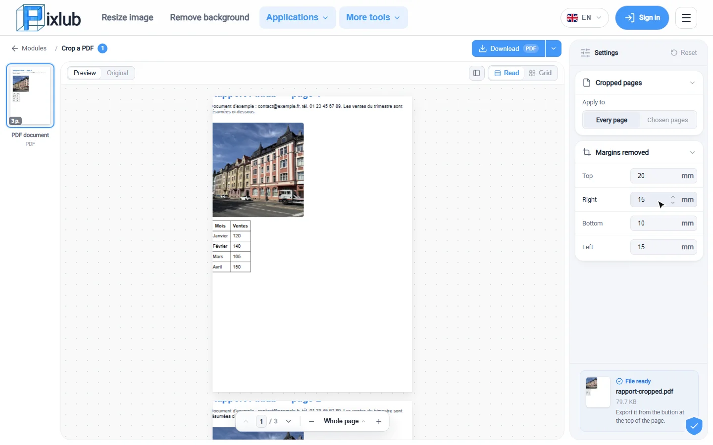

# Recortar un PDF

Quitar un margen alrededor de las páginas, sin tocar su contenido.

**Categoría** : Documentos · **Identificador** : `docCrop`

## Dónde usarlo

- **[Página del módulo](https://pixlub.com/es/module/docCrop)** : Suelte sus archivos, ajuste y descargue: el módulo por sí solo, sin nada más.

## Presentación en video

▶ [Ver el video](../../../../assets/modules/docCrop/demo.en.mp4) : Márgenes eliminados y luego recorte página por página.

1. `0:00` Import a PDF
2. `0:03` Margins removed
3. `0:14` Or page by page
4. `0:17` Download the result

## Uso

1. **Importar**

   Suelte un PDF.

2. **Ajustar los márgenes**

   Arriba, derecha, abajo, izquierda, en milímetros.

3. **O página por página**

   **Páginas elegidas** da márgenes propios a cada grupo de páginas.

## Ajustes

| Ajuste | Efecto |
| --- | --- |
| **Aplicar a** | Todas las páginas, o las páginas elegidas. |
| **Arriba** / **Derecha** / **Abajo** / **Izquierda** | 0 a 500 mm. |
| **Recortes** | Modo Páginas elegidas: una línea por grupo de páginas. |

## Consejos

- El contenido recortado solo queda oculto: para eliminar de verdad un texto, use [Censurar](../docRedact/README.md).
