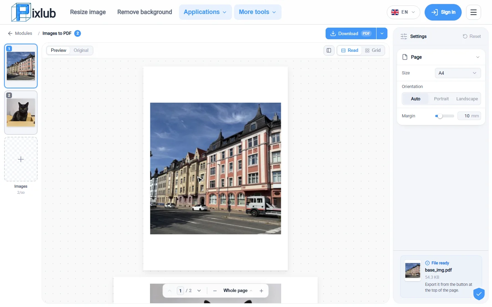

# Imágenes a PDF

Reunir imágenes en un PDF, una imagen por página.

**Categoría** : Documentos · **Identificador** : `docImagesToPdf`

## Dónde usarlo

- **[Página del módulo](https://pixlub.com/es/module/docImagesToPdf)** : Suelte sus archivos, ajuste y descargue: el módulo por sí solo, sin nada más.

## Presentación en video

▶ [Ver el video](../../../../assets/modules/docImagesToPdf/demo.en.mp4) : Importar imágenes, formato de página, margen.

1. `0:00` Import images
2. `0:03` Page size
3. `0:09` Margin
4. `0:15` Download the result

## Uso

1. **Importar**

   Suelte sus imágenes (PNG, JPEG, WebP); reordénelas en la lista.

2. **Elegir la página**

   Formato A4, A3, A5, Carta (EE. UU.)… o el tamaño de cada imagen.

3. **Iniciar**

   Un PDF, una imagen por página.

## Ajustes

| Ajuste | Efecto |
| --- | --- |
| **Formato** | Tamaño de la imagen, A4, A3, A5, Carta (EE. UU.) o Legal (EE. UU.). |
| **Orientación** | Automática, vertical u horizontal. |
| **Margen** | 0 a 50 mm alrededor de cada imagen. |

## Consejos

- Orientación automática: cada página sigue el sentido de su imagen.
