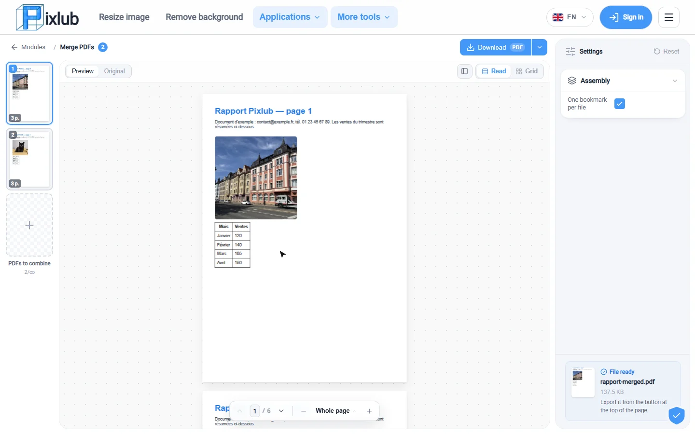

# Unir PDF

Reunir varios PDF en un solo archivo, en el orden elegido.

**Categoría** : Documentos · **Identificador** : `docMerge`

## Dónde usarlo

- **[Página del módulo](https://pixlub.com/es/module/docMerge)** : Suelte sus archivos, ajuste y descargue: el módulo por sí solo, sin nada más.

## Presentación en video

▶ [Ver el video](../../../../assets/modules/docMerge/demo.en.mp4) : Importar varios PDF, marcadores, cuadrícula de páginas.

1. `0:00` Import several PDFs
2. `0:03` One bookmark per file
3. `0:13` Download the result

## Uso

1. **Importar**

   Suelte al menos dos PDF; reordénelos en la lista.

2. **Verificar**

   La vista **Cuadrícula** muestra todas las páginas seguidas.

3. **Descargar**

   Un solo PDF, en el orden de la lista.

## Ajustes

| Ajuste | Efecto |
| --- | --- |
| **Un marcador por archivo** | Añade un marcador al principio de cada documento, con el nombre de su archivo. |

## Consejos

- Para conservar después solo algunas páginas, use [Organizar las páginas](../docPages/README.md).
