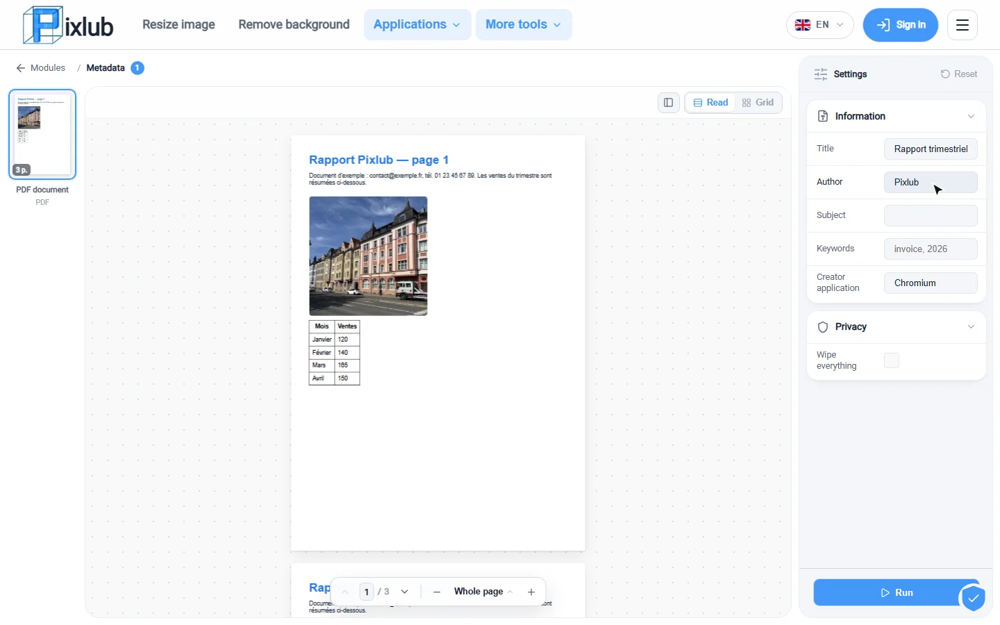

# Metadatos

Leer y modificar el título, el autor, el asunto y las palabras clave de un PDF, o borrarlos.

**Categoría** : Documentos · **Identificador** : `docMetadata`

## Dónde usarlo

- **[Página del módulo](https://pixlub.com/es/module/docMetadata)** : Suelte sus archivos, ajuste y descargue: el módulo por sí solo, sin nada más.

## Presentación en video

▶ [Ver el video](../../../../assets/modules/docMetadata/demo.en.mp4) : Modificar el título y el autor, o borrarlo todo.

1. `0:00` Import a PDF
2. `0:03` Edit title and author
3. `0:13` Or wipe everything
4. `0:22` Download the result

## Uso

1. **Importar**

   Suelte un PDF: sus metadatos actuales rellenan los campos.

2. **Modificar**

   Título, autor, asunto, palabras clave, aplicación de origen.

3. **O borrarlo todo**

   Antes de compartir un archivo, para no dejar nada.

## Ajustes

| Ajuste | Efecto |
| --- | --- |
| **Título**, **Autor**, **Asunto**, **Palabras clave**, **Aplicación de origen** | Información del documento. |
| **Borrar todo** | También elimina el productor, las fechas y los metadatos XMP. |

## Consejos

- El título se muestra en la pestaña del navegador al abrir el PDF.
