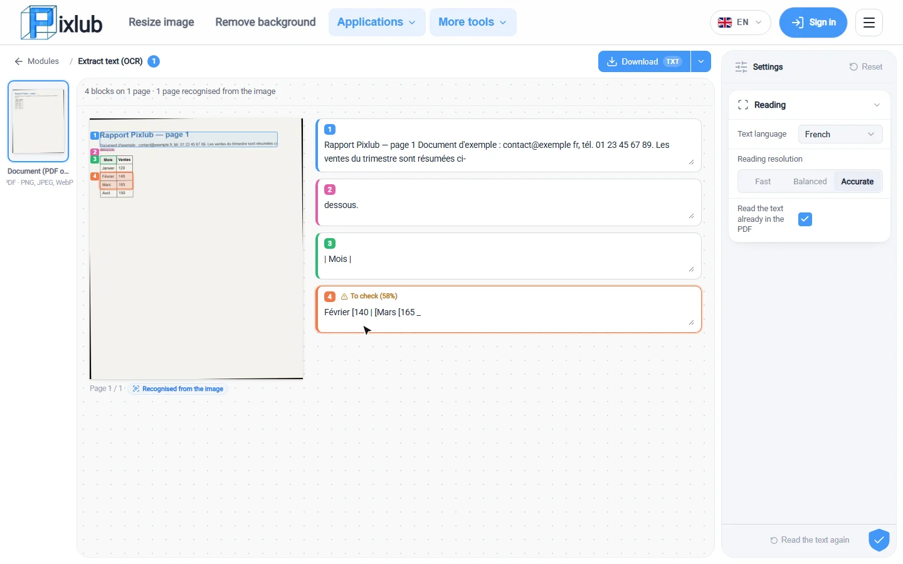

# Extraer el texto (OCR)

Leer el texto de un PDF, de un escaneo o de la foto de un documento.

**Categoría** : Documentos · **Identificador** : `docOcrText`

## Dónde usarlo

- **[Página del módulo](https://pixlub.com/es/module/docOcrText)** : Suelte sus archivos, ajuste y descargue: el módulo por sí solo, sin nada más.

## Presentación en video

▶ [Ver el video](../../../../assets/modules/docOcrText/demo.en.mp4) : Escaneo importado, bloques que revisar, idioma y resolución.

1. `0:00` Import a scan
2. `0:06` Review the blocks
3. `0:08` Language and resolution
4. `0:14` Download the result

## Uso

1. **Importar**

   Un PDF, un escaneo o una foto (PNG, JPEG, WebP).

2. **Revisar**

   El texto se muestra bloque por bloque; los bloques dudosos se marcan como «Por revisar» y se corrigen allí mismo.

3. **Descargar**

   En texto sin formato o en PDF con texto buscable.

## Ajustes

| Ajuste | Efecto |
| --- | --- |
| **Idioma del texto** | Mejora el reconocimiento de los acentos y de las palabras. |
| **Resolución de lectura** | Rápida, equilibrada o precisa (300 ppp). |
| **Leer el texto que ya contiene el PDF** | Una página que ya tiene su texto se lee tal cual, sin errores. |

## Consejos

- El reconocimiento se ejecuta en su navegador: el documento no se envía.
