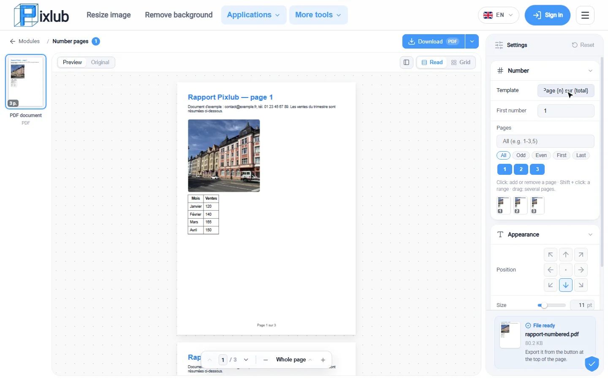

# Numerar las páginas

Añadir un número en cada página, en el lugar y con el formato elegidos.

**Categoría** : Documentos · **Identificador** : `docPageNumbers`

## Dónde usarlo

- **[Página del módulo](https://pixlub.com/es/module/docPageNumbers)** : Suelte sus archivos, ajuste y descargue: el módulo por sí solo, sin nada más.

## Presentación en video

▶ [Ver el video](../../../../assets/modules/docPageNumbers/demo.en.mp4) : Modelo del número, posición y tamaño.

1. `0:00` Import a PDF
2. `0:03` Number template
3. `0:13` Position and size
4. `0:21` Download the result

## Uso

1. **Importar**

   Suelte un PDF.

2. **Escribir el modelo**

   `{n}` es el número y `{total}`, el número de páginas: `Página {n} de {total}`.

3. **Colocar**

   Posición, tamaño, margen y color.

## Ajustes

| Ajuste | Efecto |
| --- | --- |
| **Modelo** | Texto con `{n}` y `{total}`. |
| **Primer número** | Número de la primera página numerada. |
| **Páginas** | Páginas que reciben un número. |
| **Posición** / **Tamaño** / **Margen** / **Color** | Apariencia del número. |

## Consejos

- Para no numerar la portada, elija las páginas a partir de la 2 y empiece por el 2.
