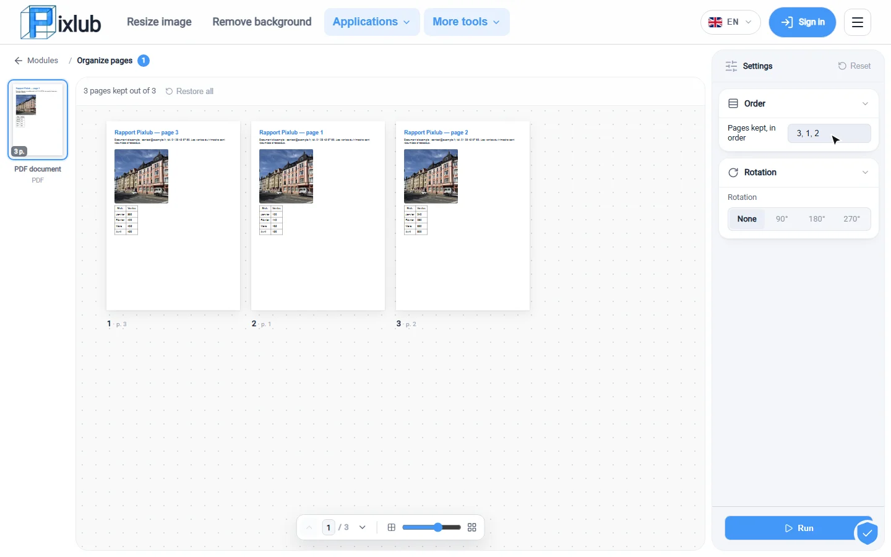

# Organizar las páginas

Conservar, eliminar, reordenar, duplicar o girar las páginas de un PDF.

**Categoría** : Documentos · **Identificador** : `docPages`

## Dónde usarlo

- **[Página del módulo](https://pixlub.com/es/module/docPages)** : Suelte sus archivos, ajuste y descargue: el módulo por sí solo, sin nada más.

## Presentación en video

▶ [Ver el video](../../../../assets/modules/docPages/demo.en.mp4) : Reordenar y luego girar páginas.

1. `0:00` Import a PDF
2. `0:03` Reorder the pages
3. `0:07` Rotate pages
4. `0:13` Download the result

## Uso

1. **Importar**

   Suelte un PDF; la cuadrícula muestra sus páginas.

2. **Elegir las páginas**

   Escriba las páginas que conservar, en orden: `3, 1, 2`. Una página ausente se elimina y una página repetida se duplica.

3. **Girar**

   Elija el ángulo y las páginas afectadas.

## Ajustes

| Ajuste | Efecto |
| --- | --- |
| **Páginas conservadas, en orden** | Lista y rangos: `1-3, 5, 2`. |
| **Rotación** | 0°, 90°, 180° o 270°. |
| **Páginas giradas** | Las páginas que reciben la rotación. |

## Consejos

- Para reorganizarlas con el mouse, abra el [Editor de PDF](../../../../01-app/es/04-document.md#editor-de-pdf).
