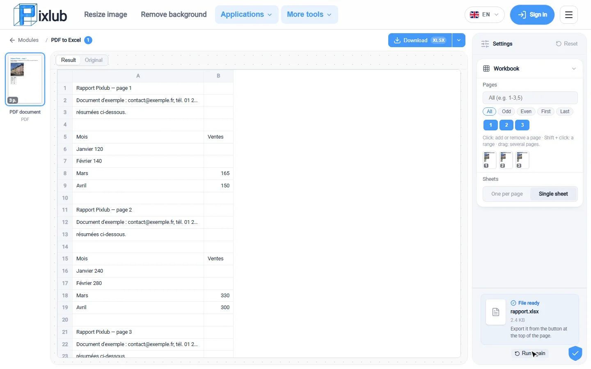

# PDF a Excel

Pasar el contenido de un PDF a un libro de cálculo, con columnas y números incluidos.

**Categoría** : Documentos · **Identificador** : `docPdfToExcel`

## Dónde usarlo

- **[Página del módulo](https://pixlub.com/es/module/docPdfToExcel)** : Suelte sus archivos, ajuste y descargue: el módulo por sí solo, sin nada más.

## Presentación en video

▶ [Ver el video](../../../../assets/modules/docPdfToExcel/demo.en.mp4) : Una hoja por página o una sola, y luego el .xlsx.

1. `0:00` Import a PDF
2. `0:03` One sheet per page, or a single one
3. `0:10` Download the result

## Uso

1. **Importar**

   Suelte un PDF con tablas.

2. **Elegir las hojas**

   Una hoja por página, o una sola hoja para todo.

3. **Iniciar**

   Las columnas alineadas se convierten en columnas y los números, en números.

## Ajustes

| Ajuste | Efecto |
| --- | --- |
| **Páginas** | Páginas que se incluyen. |
| **Hojas** | Una por página o una sola. |

## Consejos

- Los números son números de verdad: las fórmulas funcionan enseguida.
