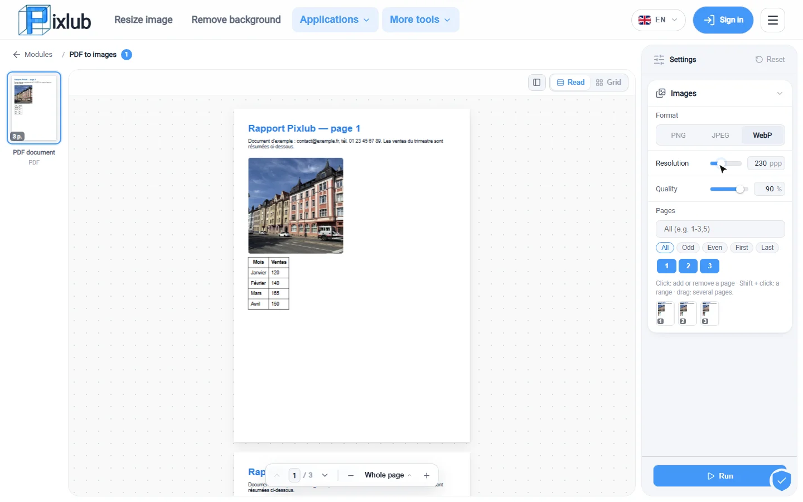

# PDF a imágenes

Exportar cada página de un PDF en PNG, JPEG o WebP.

**Categoría** : Documentos · **Identificador** : `docPdfToImages`

## Dónde usarlo

- **[Página del módulo](https://pixlub.com/es/module/docPdfToImages)** : Suelte sus archivos, ajuste y descargue: el módulo por sí solo, sin nada más.

## Presentación en video

▶ [Ver el video](../../../../assets/modules/docPdfToImages/demo.en.mp4) : Formato y resolución, elección de las páginas.

1. `0:00` Import a PDF
2. `0:03` Format and resolution
3. `0:08` Pick the pages
4. `0:14` Download the result

## Uso

1. **Importar**

   Suelte un PDF.

2. **Elegir el formato**

   PNG, JPEG o WebP, y la **resolución**.

3. **Iniciar**

   Una imagen por página, en un archivo ZIP.

## Ajustes

| Ajuste | Efecto |
| --- | --- |
| **Formato** | PNG, JPEG o WebP. |
| **Resolución** | 72 a 600 ppp. |
| **Calidad** | JPEG y WebP: 30 a 100 %. |
| **Páginas** | Todas, impares, pares, primera, última o a elegir. |

## Consejos

- 150 ppp bastan para la pantalla y 300 ppp para la impresión.
