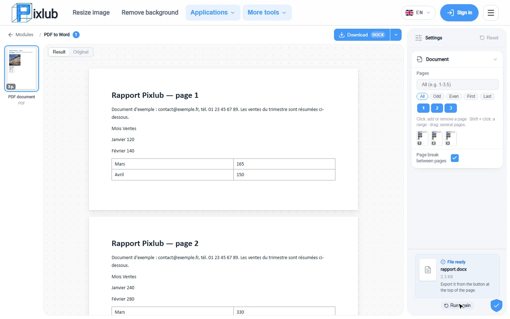

# PDF a Word

Pasar los títulos, párrafos y tablas de un PDF a un documento de Word editable.

**Categoría** : Documentos · **Identificador** : `docPdfToWord`

## Dónde usarlo

- **[Página del módulo](https://pixlub.com/es/module/docPdfToWord)** : Suelte sus archivos, ajuste y descargue: el módulo por sí solo, sin nada más.

## Presentación en video

▶ [Ver el video](../../../../assets/modules/docPdfToWord/demo.en.mp4) : Importar, iniciar, descargar el .docx.

1. `0:00` Import a PDF
2. `0:03` Pages and page breaks
3. `0:12` Download the result

## Uso

1. **Importar**

   Suelte un PDF que contenga texto.

2. **Iniciar**

   Los títulos, párrafos y tablas se pasan a un .docx.

## Ajustes

| Ajuste | Efecto |
| --- | --- |
| **Páginas** | Páginas que se incluyen. |
| **Salto de página entre las páginas** | Conserva la división en páginas del PDF. |

## Consejos

- Un PDF escaneado no tiene texto: pase primero por [Extraer el texto (OCR)](../docOcrText/README.md).
