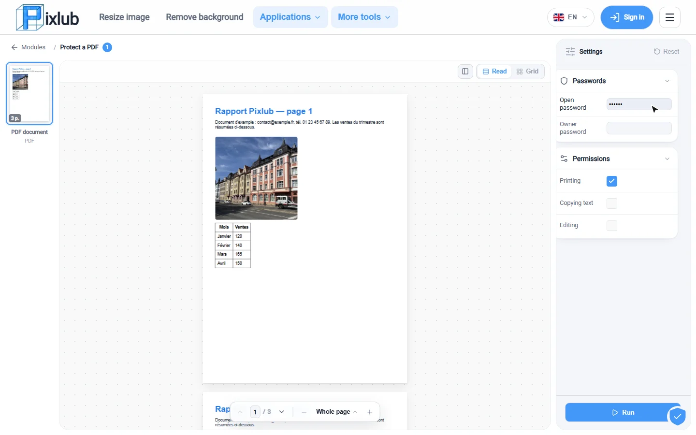

# Proteger un PDF

Cifrar un PDF con contraseña y limitar lo que se puede hacer con él.

**Categoría** : Documentos · **Identificador** : `docProtect`

## Dónde usarlo

- **[Página del módulo](https://pixlub.com/es/module/docProtect)** : Suelte sus archivos, ajuste y descargue: el módulo por sí solo, sin nada más.

## Presentación en video

▶ [Ver el video](../../../../assets/modules/docProtect/demo.en.mp4) : Contraseña de apertura, permisos.

1. `0:00` Import a PDF
2. `0:03` Open password
3. `0:07` Permissions
4. `0:13` Download the result

## Uso

1. **Importar**

   Suelte un PDF.

2. **Elegir las contraseñas**

   **Apertura** para leer el archivo y **propietario** para cambiar los permisos.

3. **Ajustar los permisos**

   Impresión, copia del texto, modificación.

## Ajustes

| Ajuste | Efecto |
| --- | --- |
| **Contraseña de apertura** | Se pide cada vez que se abre. |
| **Contraseña de propietario** | Protege los permisos. |
| **Impresión** / **Copia del texto** / **Modificación** | Lo que el lector tiene derecho a hacer. |

## Consejos

- Cifrado AES-256, hecho en su navegador: el archivo no se envía.
