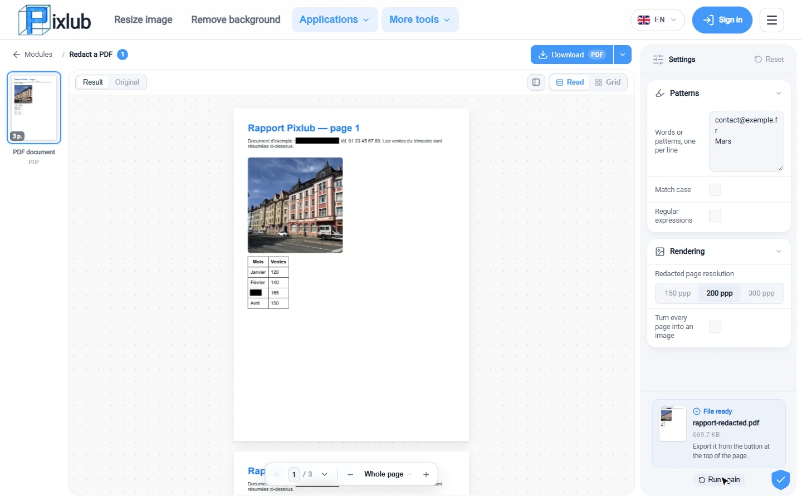

# Censurar un PDF

Tapar en negro palabras o patrones: el texto desaparece de verdad de la página.

**Categoría** : Documentos · **Identificador** : `docRedact`

## Dónde usarlo

- **[Página del módulo](https://pixlub.com/es/module/docRedact)** : Suelte sus archivos, ajuste y descargue: el módulo por sí solo, sin nada más.

## Presentación en video

▶ [Ver el video](../../../../assets/modules/docRedact/demo.en.mp4) : Palabras que tapar, resultado, antes / después.

1. `0:00` Import a PDF
2. `0:03` Words to black out
3. `0:12` Before / after
4. `0:16` Download the result

## Uso

1. **Importar**

   Suelte un PDF.

2. **Escribir las palabras**

   Una palabra o un patrón por línea: dirección, nombre, número…

3. **Iniciar**

   Compare **Resultado** y **Original** antes de descargar.

## Ajustes

| Ajuste | Efecto |
| --- | --- |
| **Palabras o patrones** | Uno por línea. |
| **Distinguir mayúsculas y minúsculas** / **Expresiones regulares** | Para apuntar con precisión, por ejemplo a un número de teléfono. |
| **Resolución de las páginas censuradas** | 150, 200 o 300 ppp. |
| **Convertir todas las páginas en imágenes** | Más seguro cuando un texto no se puede leer; archivo más pesado. |

## Consejos

- Las páginas censuradas se convierten en imágenes: su texto ya no se puede copiar.
