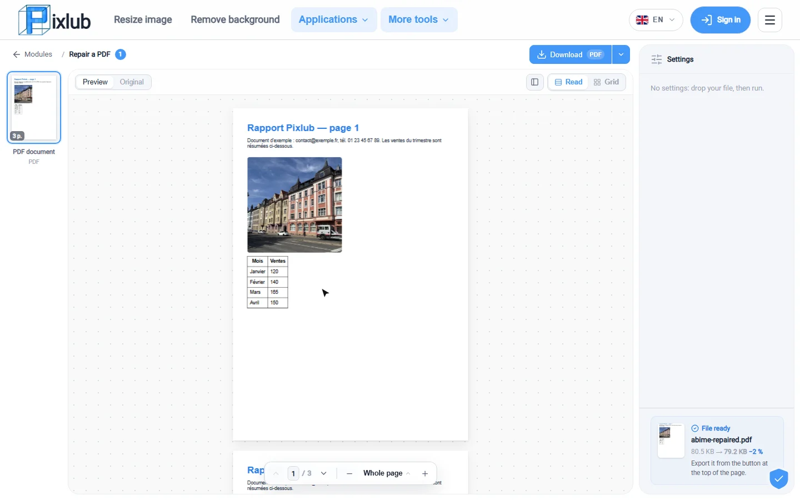

# Reparar un PDF

Reconstruir un PDF dañado o que se abre mal.

**Categoría** : Documentos · **Identificador** : `docRepair`

## Dónde usarlo

- **[Página del módulo](https://pixlub.com/es/module/docRepair)** : Suelte sus archivos, ajuste y descargue: el módulo por sí solo, sin nada más.

## Presentación en video

▶ [Ver el video](../../../../assets/modules/docRepair/demo.en.mp4) : Importar un PDF dañado y reconstruirlo.

1. `0:00` Import a damaged PDF
2. `0:03` Rebuild
3. `0:07` Download the result

## Uso

1. **Importar**

   Suelte el PDF que da problemas.

2. **Iniciar**

   Se reconstruyen la tabla de objetos, el catálogo y el árbol de páginas.

## Consejos

- Un PDF protegido con contraseña pasa primero por [Desbloquear](../docUnlock/README.md).
