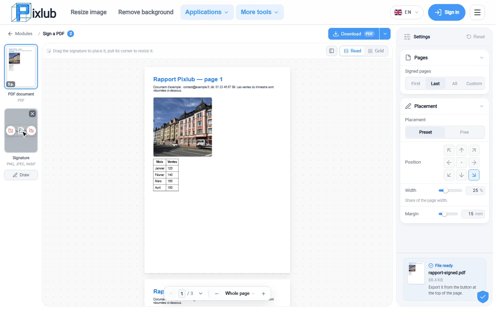

# Firmar un PDF

Colocar su firma, dibujada o importada, en las páginas elegidas.

**Categoría** : Documentos · **Identificador** : `docSign`

## Dónde usarlo

- **[Página del módulo](https://pixlub.com/es/module/docSign)** : Suelte sus archivos, ajuste y descargue: el módulo por sí solo, sin nada más.

## Presentación en video

▶ [Ver el video](../../../../assets/modules/docSign/demo.en.mp4) : PDF, firma, páginas y posición.

1. `0:00` Import a PDF
2. `0:03` Add the signature
3. `0:07` Pages and position
4. `0:15` Download the result

## Uso

1. **Importar el PDF**

   En la primera casilla.

2. **Añadir la firma**

   Importe una imagen, o use **Dibujar** con el mouse, el lápiz o el dedo.

3. **Colocar**

   Una posición predefinida, o **Libre**: arrastre la firma sobre la página y tire de su esquina para agrandarla.

## Ajustes

| Ajuste | Efecto |
| --- | --- |
| **Páginas firmadas** | Primera, última, todas o elegidas. |
| **Colocación** | Predefinida (posición y margen) o libre. |
| **Ancho** | 5 a 80 % del ancho de la página. |

## Consejos

- Se trata de una firma visual, no de una firma electrónica certificada.
