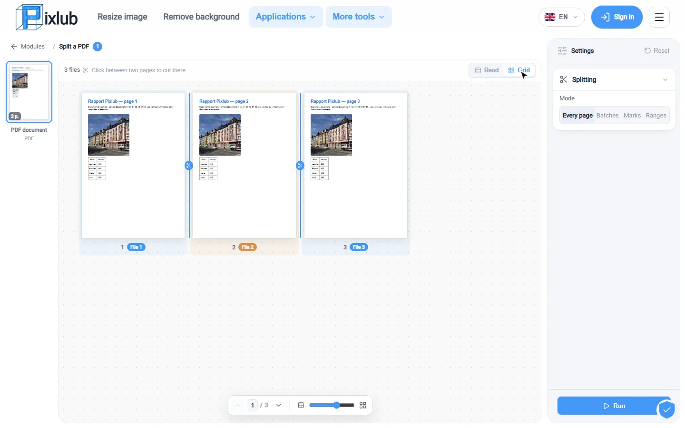

# Dividir un PDF

Separar un PDF en varios archivos: por página, por bloques, por marcas o por rangos.

**Categoría** : Documentos · **Identificador** : `docSplit`

## Dónde usarlo

- **[Página del módulo](https://pixlub.com/es/module/docSplit)** : Suelte sus archivos, ajuste y descargue: el módulo por sí solo, sin nada más.

## Presentación en video

▶ [Ver el video](../../../../assets/modules/docSplit/demo.en.mp4) : Una página por archivo, por bloques y luego por rangos.

1. `0:00` Import a PDF
2. `0:03` One page per file
3. `0:06` In batches
4. `0:10` Or by ranges
5. `0:19` Download the result

## Uso

1. **Importar**

   Suelte un PDF: la cuadrícula muestra los futuros archivos en color.

2. **Elegir el modo**

   **Cada página**, **Bloques**, **Marcas** (haga clic entre dos páginas para cortar) o **Rangos**.

3. **Iniciar**

   Los archivos se descargan en un archivo ZIP.

## Ajustes

| Ajuste | Efecto |
| --- | --- |
| **Modo** | Cada página, bloques, marcas o rangos. |
| **Páginas por archivo** | Modo Bloques: tamaño de cada bloque. |
| **Rangos** | Modo Rangos: por ejemplo `1-2, 3`. |

## Consejos

- La exportación también puede sacar cada parte en imágenes.
