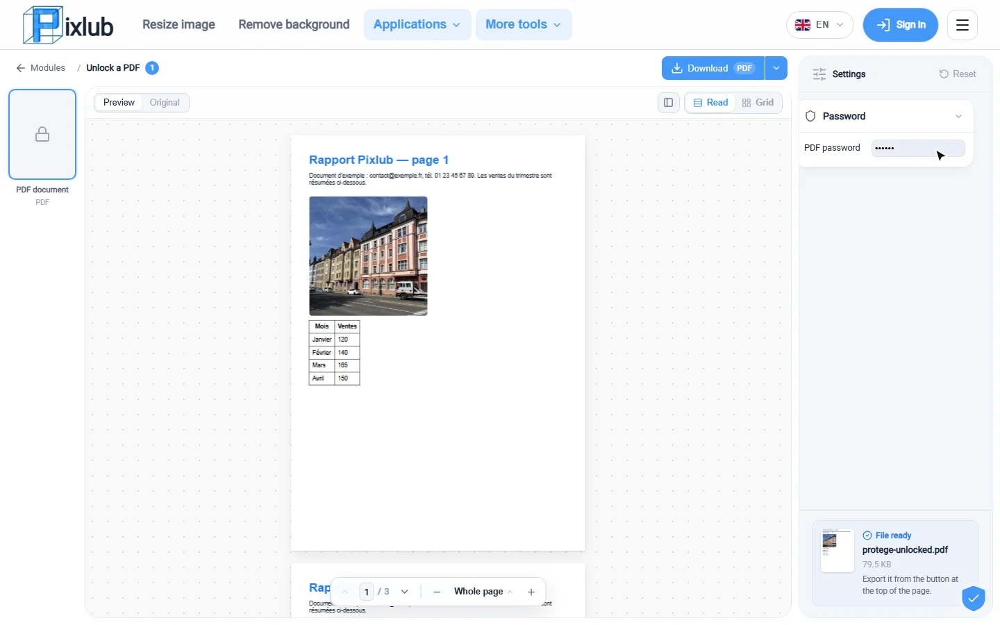

# Desbloquear un PDF

Quitar la contraseña y las restricciones de un PDF cuya contraseña conoce.

**Categoría** : Documentos · **Identificador** : `docUnlock`

## Dónde usarlo

- **[Página del módulo](https://pixlub.com/es/module/docUnlock)** : Suelte sus archivos, ajuste y descargue: el módulo por sí solo, sin nada más.

## Presentación en video

▶ [Ver el video](../../../../assets/modules/docUnlock/demo.en.mp4) : PDF protegido, contraseña, archivo libre.

1. `0:00` Import a protected PDF
2. `0:03` Type its password
3. `0:10` Download the result

## Uso

1. **Importar**

   Suelte el PDF protegido.

2. **Introducir la contraseña**

   Luego **Iniciar**: el PDF sale sin contraseña ni restricciones.

## Ajustes

| Ajuste | Efecto |
| --- | --- |
| **Contraseña del PDF** | La que abre el archivo. |

## Consejos

- Este módulo no adivina una contraseña olvidada.
