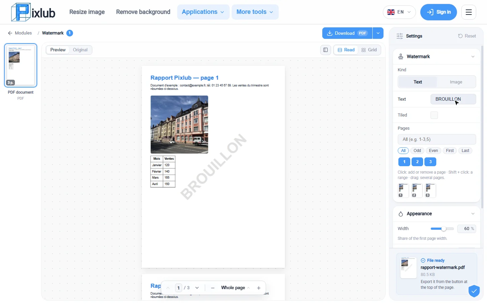

# Marca de agua

Colocar un texto o una imagen translúcida sobre las páginas de un PDF.

**Categoría** : Documentos · **Identificador** : `docWatermark`

## Dónde usarlo

- **[Página del módulo](https://pixlub.com/es/module/docWatermark)** : Suelte sus archivos, ajuste y descargue: el módulo por sí solo, sin nada más.

## Presentación en video

▶ [Ver el video](../../../../assets/modules/docWatermark/demo.en.mp4) : Texto, mosaico, opacidad e inclinación.

1. `0:00` Import a PDF
2. `0:03` Watermark text
3. `0:08` Tiled
4. `0:10` Opacity and angle
5. `0:17` Download the result

## Uso

1. **Importar**

   Suelte un PDF; para un logotipo, añada también la imagen.

2. **Elegir la marca de agua**

   **Texto** (por ejemplo «CONFIDENCIAL») o **Imagen**, una vez o en **mosaico**.

3. **Ajustar**

   Ancho, opacidad, inclinación y color; la vista previa se actualiza.

## Ajustes

| Ajuste | Efecto |
| --- | --- |
| **Tipo** | Texto o imagen. |
| **Mosaico** | Repite la marca de agua en toda la página. |
| **Páginas** | Todas, impares, pares, primera, última o a elegir. |
| **Ancho** / **Opacidad** / **Inclinación** | 5 a 100 %, 5 a 100 %, −90° a 90°. |

## Consejos

- Un PNG con fondo transparente da el mejor resultado para un logotipo.
