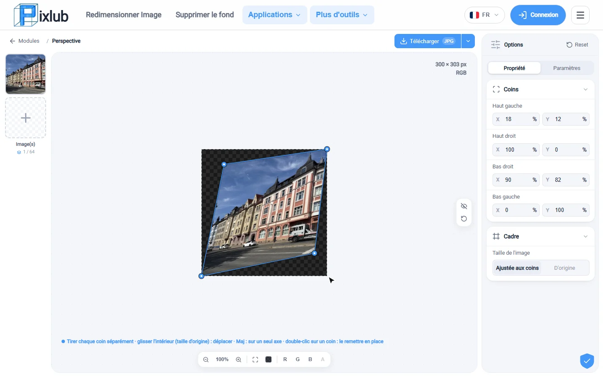

# Perspective

Déplacer librement les quatre coins d'une image pour la mettre en perspective.

**Catégorie** : Transformation · **Identifiant** : `cornerPin` · [Référence API](./api.md)

## Où l'utiliser

- **[Page du module](https://pixlub.com/fr/module/cornerPin)** : Déposez vos fichiers, réglez, téléchargez : le module seul, sans rien d'autre.
- **[Graphe d'image](https://pixlub.com/fr/image/graph)** : Reliez-le à d'autres modules pour composer un effet plus complexe.

## Entrées

Les fichiers que la page du module accepte : déposez-les sur la zone d’import, ou cliquez dessus pour parcourir. Un fichier d’un autre format est écarté, avec un message qui rappelle les formats permis.

| Entrée | Formats acceptés | Fichiers |
| --- | --- | --- |
| **Image(s)** (obligatoire) Image mise en perspective par ses quatre coins. | `PNG`, `JPEG`, `WebP`, `GIF`, `AVIF`, `BMP` | Un ou plusieurs : chaque image est traitée à part, avec les mêmes réglages |

Le nombre d’images traitées d’un coup dépend de votre offre.

Par l’API, les fichiers et leurs formats sont détaillés dans la [vue API](./api.md).

## Présentation vidéo

▶ [Voir la vidéo](../../../../assets/modules/cornerPin/demo.fr.mp4) : Tirer les coins, choisir la taille de l'image, remettre un coin.

1. `0:00` Importer une image
2. `0:02` Tirer les coins
3. `0:10` Taille de l’image
4. `0:15` Double-clic : remettre un coin
5. `0:17` Exporter le résultat

## Utilisation

1. **Importer**

   Déposez une ou plusieurs images.

2. **Tirer les coins**

   Glissez chaque coin de l'image dans l'aperçu. Glisser l'intérieur déplace l'image entière.

3. **Choisir la taille**

   **Ajustée aux coins** agrandit l'image pour tout montrer, **D'origine** garde sa taille et coupe ce qui dépasse.

## Réglages

| Réglage | Effet |
| --- | --- |
| **Haut gauche**, **Haut droit**, **Bas droit**, **Bas gauche** | Position X et Y de chaque coin, en % de l'image (−100 à 200). |
| **Taille de l'image** | **Ajustée aux coins** ou **D'origine**. |

## Astuces

- **Maj** en tirant un coin le garde sur un seul axe ; un **double-clic** sur un coin le remet en place.
- Pour poser une image sur un écran ou une affiche, réglez **D'origine** puis calez les coins sur ceux du support dans le [graphe d'image](../../../../01-app/fr/02-image/01-image-graph.md).

## Exportation

Le bouton **Télécharger** enregistre le résultat dans le format du fichier importé : une photo JPEG ressort en JPEG. Le menu à sa droite ouvre les **Paramètres d’export** pour choisir un autre format, régler la qualité, la taille ou le fond, et propose **Copier l’image**.

Avec plusieurs images, le bouton devient **Téléchargement ZIP** ; le menu propose aussi les fichiers séparés, ou la seule image affichée.

- **[La modale d’exportation](../../../../01-app/fr/02-image/04-exportation.md)** : Tous les formats, leurs réglages, le traitement local ou serveur, les lots et le dossier local.
