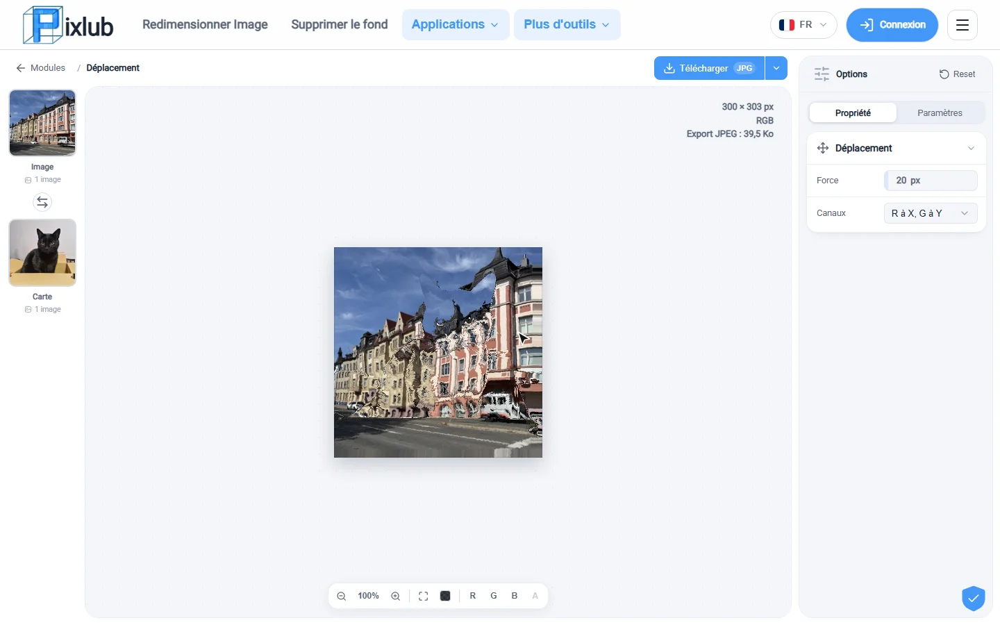

# Déplacement

Déformer une image selon une seconde image, la carte de déplacement.

**Catégorie** : Transformation · **Identifiant** : `displace` · [Référence API](./api.md)

## Où l'utiliser

- **[Page du module](https://pixlub.com/fr/module/displace)** : Déposez vos fichiers, réglez, téléchargez : le module seul, sans rien d'autre.
- **[Graphe d'image](https://pixlub.com/fr/image/graph)** : Reliez-le à d'autres modules pour composer un effet plus complexe.

## Entrées

Les fichiers que la page du module accepte : déposez-les sur la zone d’import, ou cliquez dessus pour parcourir. Un fichier d’un autre format est écarté, avec un message qui rappelle les formats permis.

| Entrée | Formats acceptés | Fichiers |
| --- | --- | --- |
| **Image** (obligatoire) Image déformée. | `PNG`, `JPEG`, `WebP`, `GIF`, `AVIF`, `BMP` | Un fichier |
| **Carte** (obligatoire) Image de référence pour le déplacement des pixels. | `PNG`, `JPEG`, `WebP`, `GIF`, `AVIF`, `BMP` | Un fichier |

Par l’API, les fichiers et leurs formats sont détaillés dans la [vue API](./api.md).

## Présentation vidéo

▶ [Voir la vidéo](../../../../assets/modules/displace/demo.fr.mp4) : Image, carte, force et canaux.

1. `0:00` Importer une image
2. `0:02` Ajouter la carte
3. `0:04` Force du déplacement
4. `0:08` Canaux lus dans la carte
5. `0:12` Exporter le résultat

## Utilisation

1. **Importer l'image**

   Déposez l'image à déformer dans la case **Image**.

2. **Ajouter la carte**

   Déposez une seconde image dans la case **Carte** : ses couleurs décident du déplacement de chaque pixel.

3. **Doser**

   Réglez la **force**, puis les **canaux** lus dans la carte.

## Réglages

| Réglage | Effet |
| --- | --- |
| **Force** | Déplacement maximal, 0 à 500 px. |
| **Canaux** | **R à X, G à Y** : le rouge pousse en largeur, le vert en hauteur. **Luminance** : la clarté pousse sur les deux axes. |

## Astuces

- Une carte de bruit ou de nuages donne un effet de verre dépoli ou de chaleur.
- Une carte floue déforme en douceur ; une carte nette crée des cassures.

## Exportation

Le bouton **Télécharger** enregistre le résultat dans le format du fichier importé : une photo JPEG ressort en JPEG. Le menu à sa droite ouvre les **Paramètres d’export** pour choisir un autre format, régler la qualité, la taille ou le fond, et propose **Copier l’image**.

- **[La modale d’exportation](../../../../01-app/fr/02-image/04-exportation.md)** : Tous les formats, leurs réglages, le traitement local ou serveur, les lots et le dossier local.
